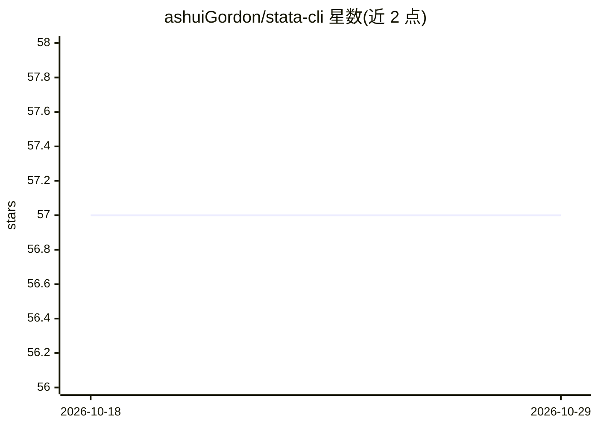

# ashuiGordon/stata-cli

⭐ 57 · Python · 推送 2026-10-28 · [GitHub](https://github.com/ashuiGordon/stata-cli) · [官网](https://ashuigordon.github.io/stata-cli/) · 个人维护 · 中文 README

**供 AI 编程代理调用 Stata 的命令行工具**

基于 PyStata 封装的 Stata 命令行界面，让 Codex、Claude Code、Cursor 等 AI 编程代理通过终端执行 Stata 代码与 .do 文件、以 JSON 查看数据集、变量元数据、r()/e()/s() 存储结果与矩阵，并自动导出图形。后台守护进程将执行耗时从约 2-3 秒降至约 85ms，支持并行会话与 token 上限管理。要求本机已安装 Stata 17+ 与 Python 3.9+，可通过 pip、npm/npx 或源码安装。

## 筛选速览

| 维度 | 判定 | 备注 |
|---|---|---|
| AI 角色 | `ai-ecosystem` | LLM/agent 周边工具 |
| 许可风险 | `permissive` | — |
| 部署形态 | `library` | 以包/库形式分发 |
| 模型依赖 | — | README 未给出锁定关系 |
| 硬件要求 | — | 无带数字的原话,不猜 |
| 安装摩擦 | `low` | 无编译、无系统依赖或容器化 |
| 成熟度 | — | 结构信号不足 |

## 能力要点

- 执行代码/.do 文件并以结构化 JSON 返回计量结果（r()/e()/s()、矩阵）
- 守护进程模式将启动耗时从约 2-3s 降至约 85ms，支持并行会话
- 内置 57 个主题的 Stata 参考库（含计量经济学、因果推断、社区包）
- 图形自动检测导出 PNG/SVG/PDF 与 token 上限管理

## 适用场景

- 让 Claude Code/Codex/Cursor 等 AI 代理直接运行 Stata 分析
- 以 JSON 形式程序化读取 Stata 数据与回归结果
- 在终端反复执行 Stata 命令且保持亚秒级响应

## 场景标签

`数据分析` `科研工具` · 领域:效率与自动化

## 证据(README 行号)

> L13: An agent-native command-line interface for Stata via PyStata. Let Codex, Claude Code, Cursor, and other AI coding a
> L19: - **Agent-Native Design** — Structured JSON output, exit codes, and a SKILL.md definition out of the box — AI Agent
> L50: - **Stata 17+** installed on your machine (provides the PyStata library)

## 星数曲线

2026-10-18 57 → 2026-10-29 57（+0）

---
*卡片 v1 · prompt 1.4 · 生成 2026-10-24 · 置信度 high · 依据 README sha `ab8f6092d4bf` · [字段定义](../../DATASET.md)*
