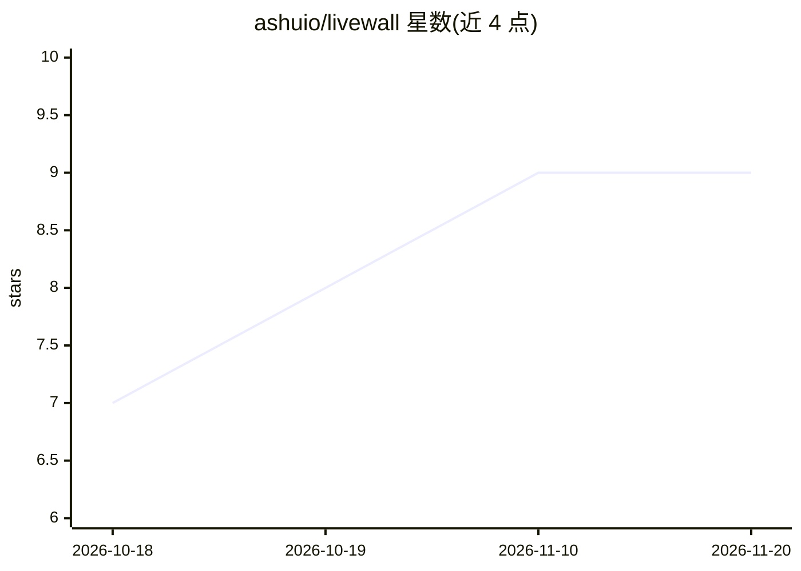

# ashuio/livewall

⭐ 9 · Python · Apache-2.0 · 推送 2026-10-12 · [GitHub](https://github.com/ashuio/livewall) · [官网](https://ashu.io/projects/livewall/) · 个人维护

**让 AI agent 边工作边写入的实时状态看板**

Livewall 提供一个由 AI agent 在执行任务时实时更新的浏览器状态看板：agent 通过 MCP 工具、HTTP 或 CLI 发送 JSON board spec，后端存储并校验，浏览器经 SSE 实时渲染。支持进度条、表格、日志、图表等 17 种块类型，每个任务一个命名看板并以标签页呈现，看板按 TTL 过期不留持久状态。默认绑定 loopback，可选 bearer-token 认证。面向使用 MCP 客户端驱动长任务的 agent 用户。

## 筛选速览

| 维度 | 判定 | 备注 |
|---|---|---|
| AI 角色 | `ai-ecosystem` | LLM/agent 周边工具 |
| 许可风险 | `permissive` | Apache-2.0 |
| 部署形态 | `self-host` | docker 或自建部署 |
| 模型依赖 | — | README 未给出锁定关系 |
| 硬件要求 | — | 无带数字的原话,不猜 |
| 安装摩擦 | `low` | 无编译、无系统依赖或容器化 |
| 成熟度 | `idea` | |

## 能力要点

- MCP server 提供 11 个工具（set_board/update_block/describe_blocks 等）供 agent 编程看板
- 三种接入方式：MCP、HTTP API 与 CLI（pipx 安装，stdlib only）
- 17 种块类型经 SSE 实时渲染，支持手机/平板/桌面三档响应式与 kiosk 模式
- 看板按 TTL 过期，运行中看板 3600s 空闲后回收，内存存储

## 适用场景

- 长任务迁移过程中让 agent 实时展示进度条
- 展示测试结果表格与日志尾部
- CI 步骤或 cron 任务推送状态到浏览器
- 多 agent 会话的状态墙监控

## 场景标签

 · 领域:AI 基础设施/agent 可观测性

## 证据(README 行号)

> L5: **Livewall is a live status board your AI agent writes while it works.**
> L42:        │   MCP tool calls: set_board / update_block / update_board / …
> L101: Add the MCP server to your client. Most MCP clients — Claude Desktop, Cursor,

## 星数曲线

2026-10-18 7 → 2026-11-20 9（+2）

---
*卡片 v1 · prompt 1.4 · 生成 2026-11-20 · 置信度 high · 依据 README sha `7bff50806cb8` · [字段定义](../../DATASET.md)*
