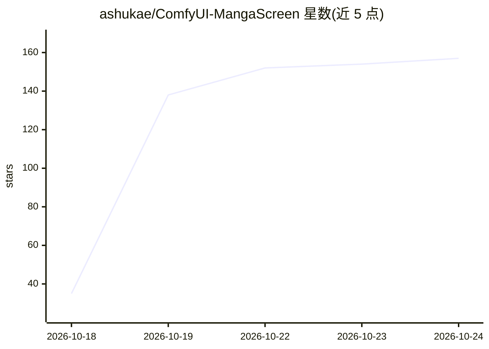

# ashukae/ComfyUI-MangaScreen

⭐ 158 · Python · MIT · 推送 2026-10-24 · [GitHub](https://github.com/ashukae/ComfyUI-MangaScreen) · 个人维护

**ComfyUI 漫画/黑白漫画滤镜节点包，含网目调与分格处理**

面向 ComfyUI 用户的自定义节点包：Manga Finish 将插画转换为黑白漫画稿（线条分层保留、明暗推平、按需贴真实网目调、45° 单一网点二值输出、黑底留白线），Manga Panel 裁切分格并加边框纸感，Manga Levels 提供灰度+色阶预处理。附带两套工作流：QWEN-Manga 先用 Qwen-Image 2.1 Turbo 做语义重绘再上滤镜；Manga-Lite 无需编辑模型，CPU 可运行。安装方式为 git clone 到 custom_nodes，依赖 opencv-python 与 numpy（通常随 ComfyUI 已装）。

## 筛选速览

| 维度 | 判定 | 备注 |
|---|---|---|
| AI 角色 | `ai-ecosystem` | LLM/agent 周边工具 |
| 许可风险 | `permissive` | MIT |
| 部署形态 | `None` |  |
| 模型依赖 | — | README 未给出锁定关系 |
| 硬件要求 | — | 无带数字的原话,不猜 |
| 安装摩擦 | `low` | 无编译、无系统依赖或容器化 |
| 成熟度 | — | 结构信号不足 |

## 能力要点

- Manga Finish 按形状分离线条并保持锐利黑线
- 明暗压缩为纸白/淡调/浓调/纯黑四档并输出 45° 单网点二值页
- QWEN-Manga 工作流先经 Qwen-Image 2.1 Turbo 语义重绘
- Manga-Lite 工作流无需编辑模型，CPU 可运行

## 适用场景

- 把插画转成印刷感的黑白漫画分格页面
- 在 ComfyUI 中给线稿自动铺设网目调网点
- 无 GPU 环境下用 Manga-Lite 工作流做漫画化处理

## 场景标签

`图像视频处理` · 领域:感知与多模态

## 证据(README 行号)

> L3: A manga / black & white comic filter for ComfyUI. Turn an illustration into a clean B&W manga or comic page — lines 
> L79: - Models: Qwen-Image 2.1 Turbo (diffusion model), a Qwen-Image 2.1 text encoder and VAE — select your own files in 

## 星数曲线

2026-10-18 35 → 2026-10-24 157（+122）

---
*卡片 v1 · prompt 1.4 · 生成 2026-10-22 · 置信度 high · 依据 README sha `6a22e8f386f9` · [字段定义](../../DATASET.md)*
