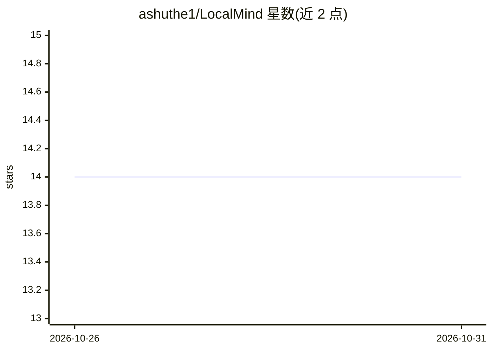

# ashuthe1/LocalMind

⭐ 14 · JavaScript · MIT · 推送 2026-10-24 · [GitHub](https://github.com/ashuthe1/LocalMind) · 个人维护

**自托管的多 LLM 私密聊天界面，对话数据本地存储**

Go 单二进制同时提供 API 与 Web UI 的自托管聊天应用，可连接本地模型服务（Ollama、LM Studio、llama.cpp、vLLM、LocalAI、Jan）及云端 API（OpenAI、Anthropic、Gemini、DeepSeek 等），对话历史、用户资料与设置存于本地嵌入式 SQLite，可作为 PWA 安装并支持手机访问。支持多 provider 按对话切换、图片输入、推理模型思考流、消息编辑与重新生成、本地备份恢复。应用无登录机制，绑定 0.0.0.0 时同网络用户可读取聊天与 API key，需置于可信网络或反向代理后。

## 筛选速览

| 维度 | 判定 | 备注 |
|---|---|---|
| AI 角色 | `ai-native` | 本体是模型或模型工具 |
| 许可风险 | `permissive` | MIT |
| 部署形态 | `self-host` | docker 或自建部署 |
| 模型依赖 | local-ok | 支持本地模型 |
| 硬件要求 | — | 无带数字的原话,不猜 |
| 安装摩擦 | `low` | 无编译、无系统依赖或容器化 |
| 成熟度 | — | 结构信号不足 |

## 能力要点

- 单一 Go 二进制内嵌 UI 与 SQLite，无需独立数据库
- 支持本地（Ollama/LM Studio/llama.cpp/vLLM）与云端 API 多 provider 按对话切换
- 视觉模型图片输入、推理思考流折叠展示、每条回复实时 token 统计
- 提供 Docker Compose（含 Ollama sidecar）与预编译二进制

## 适用场景

- 在自己设备上搭建私密 LLM 聊天界面，不把对话交给第三方
- 同一界面下在本地与多家云端模型之间按需切换
- 手机在同一 Wi-Fi 下访问自托管的聊天服务

## 场景标签

`聊天机器人` · 领域:对话与助手

## 证据(README 行号)

> L5:  A private, self-hosted chat UI for any LLM — local or cloud — with every conversation stored on your own machine.
> L12: LocalMind gives you a ChatGPT-style experience without handing your conversations to anyone. It talks to the model 

## 星数曲线

2026-10-26 14 → 2026-10-31 14（+0）

---
*卡片 v1 · prompt 1.4 · 生成 2026-10-31 · 置信度 high · 依据 README sha `4ec31ff052a7` · [字段定义](../../DATASET.md)*
