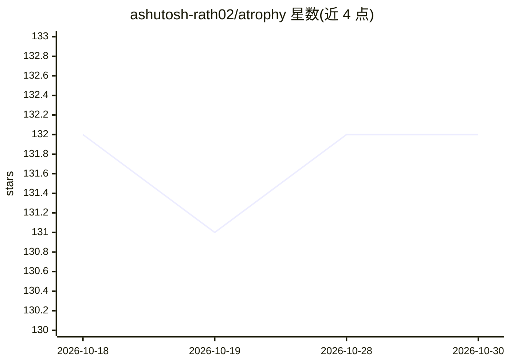

# ashutosh-rath02/atrophy

⭐ 132 · TypeScript · MIT · 推送 2026-07-16 · [GitHub](https://github.com/ashutosh-rath02/atrophy) · [官网](https://ashutosh-rath02.github.io/atrophy/) · 个人维护

**测量 AI 依赖导致编程能力衰退的 CLI 训练与评分工具**

命令行应用：定期在无 AI 辅助下完成小型编程练习（Python/JavaScript，五个技能维度），在沙箱子进程中用隐藏测试自动评分，维护类 Elo 技能评级并在本地仪表盘绘制随周变化的曲线与置信区间；每月可用 --ai-on 做一次允许 AI 的对照测试，仪表盘展示有无 AI 的分差。数据存于单个 SQLite 文件，无账号、无遥测。启动无辅助练习时会检测正在运行的 AI 助手并打印警告（不阻止）。面向关注自身无辅助编程能力的开发者，需 Node.js ≥22。

## 筛选速览

| 维度 | 判定 | 备注 |
|---|---|---|
| AI 角色 | `ai-enhanced` | 去掉 AI 部分产品仍成立 |
| 许可风险 | `permissive` | MIT |
| 部署形态 | `library` | 以包/库形式分发 |
| 模型依赖 | — | README 未给出锁定关系 |
| 硬件要求 | — | 无带数字的原话,不猜 |
| 安装摩擦 | `low` | 无编译、无系统依赖或容器化 |
| 成熟度 | — | 结构信号不足 |

## 能力要点

- 五技能维度（语法回忆/调试/读代码/API 记忆/分解）自动评分与 Elo 式评级
- 生成器族按种子生成可复现的练习变体，难度瞄准预测成功率约 65%
- 无辅助 vs AI 辅助的分差图表与置信区间可视化
- 练习在 $EDITOR 中进行，评分运行于沙箱子进程的隐藏测试

## 适用场景

- 我想量化自己依赖 Copilot 后无辅助编码能力的变化
- 定期做 5-10 分钟练习维持编程手感并跟踪评级
- 面试或断网前确认自己仍能独立写出代码

## 场景标签

 · 领域:开发者工具/技能评估

## 证据(README 行号)

> L9: Atrophy is a command-line app that regularly hands you a small coding exercise
> L25: 4. **Once a month: `atrophy drill --ai-on`** - take one drill *with* your AI
> L139:  while a known AI assistant is running (Copilot, Cursor, Claude, Windsurf,

## 星数曲线

2026-10-18 132 → 2026-10-30 132（+0）

---
*卡片 v1 · prompt 1.4 · 生成 2026-10-22 · 置信度 high · 依据 README sha `16454339ae15` · [字段定义](../../DATASET.md)*
