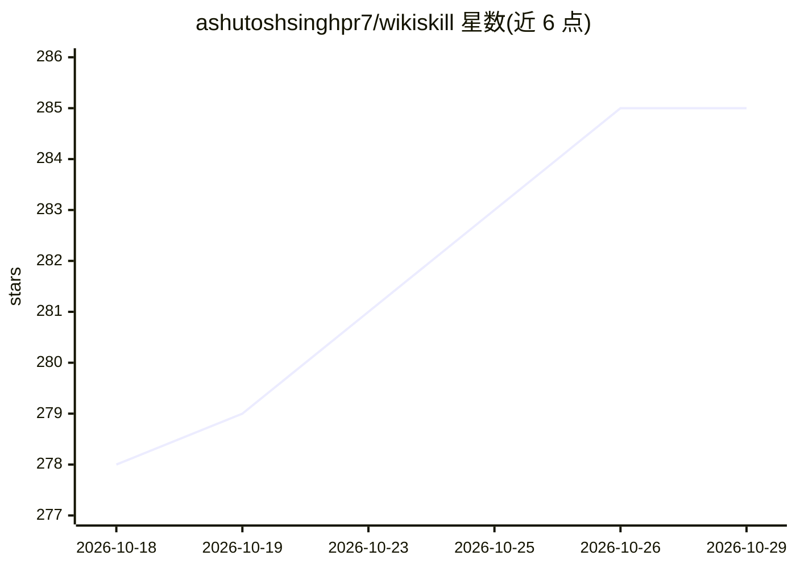

# ashutoshsinghpr7/wikiskill

⭐ 285 · Python · MIT · 推送 2026-09-15 · [GitHub](https://github.com/ashutoshsinghpr7/wikiskill) · [官网](https://ashutoshsinghpr7.github.io/wikiskill/) · 个人维护

**论文 WikiSkill 的实现：Agent 经验编译为持久 wiki 驱动技能自进化**

Python 实现的 agent 技能自进化框架，忠实复现 arXiv:2608.27454 的 Algorithm 1：agent 在隔离工作区运行训练任务生成执行 trace，Wiki Maintainer agent 将 trace 蒸馏为 wiki 模式页，Skill Proposer agent 提出技能变更，经 held-out 任务验证严格优于历史最佳才保留，否则 git 回滚（wiki 不回滚）。默认以 Hermes Agent 为参考后端，内置 Claude Code、Codex、GitHub Copilot CLI 后端，支持 OpenRouter 等模型提供方。PyPI 安装，附 CLI 与 22 任务的自动评分基准，并如实记录了多次 gate 拒绝的实跑结果。

## 筛选速览

| 维度 | 判定 | 备注 |
|---|---|---|
| AI 角色 | `ai-ecosystem` | LLM/agent 周边工具 |
| 许可风险 | `permissive` | MIT |
| 部署形态 | `library` | 以包/库形式分发 |
| 模型依赖 | — | README 未给出锁定关系 |
| 硬件要求 | — | 无带数字的原话,不猜 |
| 安装摩擦 | `low` | 无编译、无系统依赖或容器化 |
| 成熟度 | — | 结构信号不足 |

## 能力要点

- 忠实实现 Algorithm 1：maintainer→proposer→gating→rollback 闭环
- 每工作区隔离 agent profile，gate 严格 R_val > R_best
- 支持 Hermes/Claude Code/Codex/Copilot 四种后端，技能跨后端迁移
- 兼作 Hermes skills tap，可安装蒸馏出的模式技能

## 适用场景

- 在我的 agent 上跑技能自进化实验循环
- 把 agent 执行经验蒸馏成可复用的 wiki 与 SKILL.md
- 用自带基准验证某个模型能否从经验中积累技能

## 场景标签

`Agent 框架` `Agent 记忆` · 领域:Agent 开发

## 证据(README 行号)

> L17: Agents fail. They also *learn* — but the lessons usually die with the session. WikiSkill fixes that by keeping a **
> L19: 1. The agent runs **training tasks** with its current skills → raw execution traces
> L21: 3. A **Skill Proposer** agent reads the wiki + traces and proposes one skill change (create or patch)

## 星数曲线

2026-10-18 278 → 2026-10-29 285（+7）

---
*卡片 v1 · prompt 1.4 · 生成 2026-10-22 · 置信度 high · 依据 README sha `b9934a0ff4ee` · [字段定义](../../DATASET.md)*
