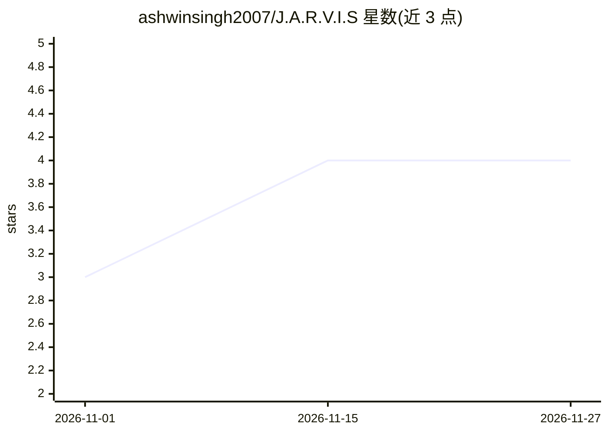

# ashwinsingh2007/J.A.R.V.I.S

⭐ 4 · JavaScript · MIT · 推送 2026-11-01 · [GitHub](https://github.com/ashwinsingh2007/J.A.R.V.I.S) · [官网](https://ashwinsingh2007.github.io/J.A.R.V.I.S/) · 个人维护

**macOS 语音助手：唤醒词对话、本地语音与记忆，Claude Code 驱动**

面向 Mac 用户的开源语音助手，以'Jarvis, wake up'唤醒后连续对话。语音识别与 Kokoro 神经语音默认本地运行，支持记忆存储、晨间简报、语音提醒与例程。默认以 Claude Code 为'大脑'获得完整功能，也可接 Anthropic API、Gemini 或 Ollama 本地模型（工具集较小）。内建五个可切换/自定义的助手角色，配 HUD 显示、终端 jarvis 命令、Telegram 接入与多机 MESH 协同。Electron + Swift 构建，MIT 许可，仅支持 macOS。

## 筛选速览

| 维度 | 判定 | 备注 |
|---|---|---|
| AI 角色 | `ai-native` | 本体是模型或模型工具 |
| 许可风险 | `permissive` | MIT |
| 部署形态 | `None` |  |
| 模型依赖 | local-ok | 支持本地模型 |
| 硬件要求 | — | 无带数字的原话,不猜 |
| 安装摩擦 | `low` | 无编译、无系统依赖或容器化 |
| 成熟度 | `idea` | |

## 能力要点

- 唤醒词语音对话，识别与 Kokoro TTS 默认在 Mac 本地运行
- 五助手角色（JARVIS/FRIDAY/KAREN/EDITH/VISION），可自定义、导入导出
- 读写 Chrome 中的 Gmail/YouTube、文件 shell、macOS 无障碍控制其他应用
- 技能与 MCP 服务器管理，操作前读回任务等待确认

## 适用场景

- 免手动在 Mac 上语音下达任务并让它在后台执行
- 让助手管理收件箱、起草回复并追踪跟进事项
- 设置每日语音简报与例程（如每天早上检查 AI 新闻）
- 无 Claude 订阅时用 Gemini 免费额度或 Ollama 本地模型运行

## 场景标签

`语音 Agent` `AI 助手` · 领域:对话与助手

## 证据(README 行号)

> L5:  A voice assistant for your Mac, inspired by Iron Man's JARVIS. Say "Jarvis, wake up" and talk to it. It answers out
> L17: JARVIS is built Claude Code first. It works best with Claude Code and your Claude plan, and you can also run it on 

## 星数曲线

2026-11-01 3 → 2026-11-27 4（+1）

---
*卡片 v1 · prompt 1.4 · 生成 2026-11-21 · 置信度 high · 依据 README sha `0ca96bef2614` · [字段定义](../../DATASET.md)*
