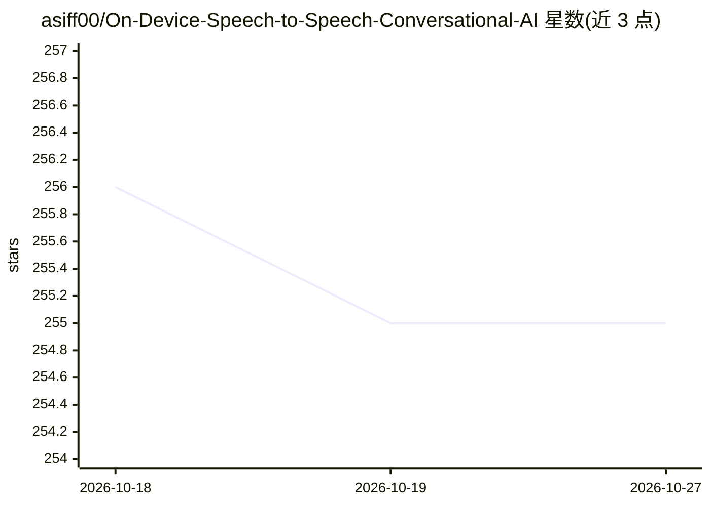

# asiff00/On-Device-Speech-to-Speech-Conversational-AI

⭐ 255 · Python · MIT · 推送 2025-11-24 · [GitHub](https://github.com/asiff00/On-Device-Speech-to-Speech-Conversational-AI) · [官网](https://youtu.be/x92FLnwf-nA) · 个人维护

**全本地 CPU 实时语音对话系统：VAD→ASR→LLM→TTS 流水线**

面向希望在单机 CPU 上运行语音助手的用户：将 Pyannote VAD、Whisper-tiny.en、Ollama 托管的 qwen2.5 小模型与 Kokoro-82M TTS 组合成多线程流式架构，通过队列管理衔接各环节，支持随时打断对话。为降低感知延迟，采用基于优先级的 TextChunker 流式切分 LLM 输出，并让 LLM 以填充词开头实现快速首响应；作者在无 GPU 的 Ryzen 5600G 上测得约 2 秒延迟。需安装 Ollama、eSpeak NG 并通过 git clone + pip 从源码运行。

## 筛选速览

| 维度 | 判定 | 备注 |
|---|---|---|
| AI 角色 | `ai-native` | 本体是模型或模型工具 |
| 许可风险 | `permissive` | MIT |
| 部署形态 | `library` | 以包/库形式分发 |
| 模型依赖 | local-ok | 支持本地模型 |
| 硬件要求 | — | 无带数字的原话,不猜 |
| 安装摩擦 | `low` | 无编译、无系统依赖或容器化 |
| 成熟度 | — | 结构信号不足 |

## 能力要点

- VAD→Whisper→LLM→TextChunker→TTS 多线程队列化流水线
- 优先级文本切分与填充词提示，降低首响应感知延迟
- 支持用户随时打断的自然对话
- 全部组件本地 CPU 运行，无 GPU 环境实测约 2 秒延迟

## 适用场景

- 在本地 CPU 上搭建可实时对话的语音助手
- 体验低延迟、可自然打断的语音交互
- 参考其流式切分方案构建自己的语音对话系统

## 场景标签

`语音 Agent` · 领域:对话与助手

## 证据(README 行号)

> L8: This is a real-time conversational system for two-way speech communication with AI models, utilizing a continuous st
> L42: - **Voice Activity Detection**: Pyannote:pyannote/segmentation-3.0
> L43: - **Speech Recognition**: Whisper:whisper-tiny.en (OpenAI)
> L44: - **Language Model**: LM Studio/Ollama with qwen2.5:0.5b-instruct-q8_0
> L45: - **Voice Synthesis**: Kokoro:hexgrad/Kokoro-82M

## 星数曲线

2026-10-18 256 → 2026-10-27 255（-1）

---
*卡片 v1 · prompt 1.4 · 生成 2026-10-22 · 置信度 mid · 依据 README sha `5eb82bb67d9a` · [字段定义](../../DATASET.md)*
