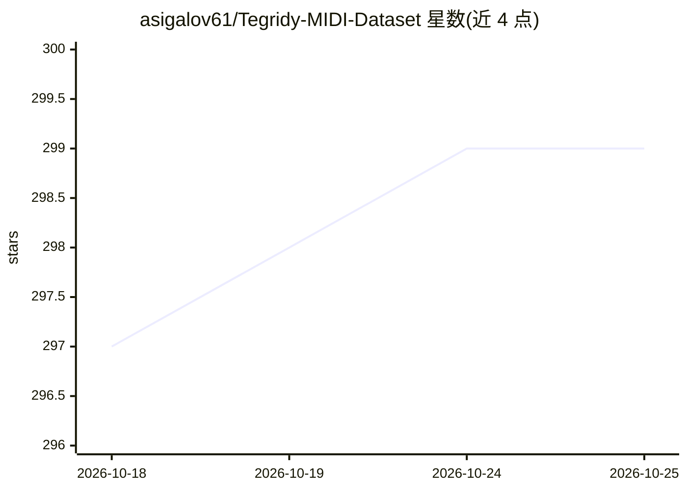

# asigalov61/Tegridy-MIDI-Dataset

⭐ 299 · Python · Apache-2.0 · 推送 2026-10-25 · [GitHub](https://github.com/asigalov61/Tegridy-MIDI-Dataset) · [官网](https://soundcloud.com/aleksandr-sigalov-61/) · 个人维护

**多乐器 MIDI 数据集聚合中心，供 MIR 与音乐 AI 研究**

由 asigalov61 维护的符号音乐资源库：自带 Tegridy MIDI Dataset、Tegridy Piano、Children Songs 等原创归一化 MIDI 集合（CC BY-NC-SA 许可），同时编目约 30 个外部 MIDI 数据集（Discover 674 万条、Godzilla 580 万条、MAESTRO、GiantMIDI、POP909 等），并汇集 FluidSynth 等软件工具、soundfonts 及 Colab AI 工具（转录、生成、humanization）。通过 git clone 获取，面向音乐信息检索与音乐 AI 模型训练场景。

## 筛选速览

| 维度 | 判定 | 备注 |
|---|---|---|
| AI 角色 | `ai-knowledge` | 知识聚合/清单类 |
| 许可风险 | `permissive` | Apache-2.0 |
| 部署形态 | `None` |  |
| 模型依赖 | — | README 未给出锁定关系 |
| 硬件要求 | — | 无带数字的原话,不猜 |
| 安装摩擦 | `low` | 无编译、无系统依赖或容器化 |
| 成熟度 | — | 结构信号不足 |

## 能力要点

- 原创归一化多乐器 MIDI 数据集集合（CC BY-NC-SA）
- 编目 30+ 外部数据集，含 Discover（674 万）与 Godzilla（580 万）大规模语料
- 覆盖 MAESTRO/POP909/ATEPP 等专门研究数据集的描述与链接
- 汇集软件工具、soundfonts 与在线/Colab AI 工具资源

## 适用场景

- 为符号音乐生成或 MIR 模型寻找训练数据
- 按任务（转录、对齐、流行/爵士/古典）挑选合适的 MIDI 数据集
- 获取音频转 MIDI、MIDI 生成等配套 AI 工具入口

## 场景标签

 · 领域:音乐信息检索/数据集

## 证据(README 行号)

> L3: ## Ultimate Multi-Instrumental MIDI Dataset for MIR and Music AI purposes
> L17: > The Tegridy MIDI Dataset is a comprehensive, multi-instrumental symbolic music resource specifically designed for
> L19: # Must-have MIDI datasets:

## 星数曲线

2026-10-18 297 → 2026-10-25 299（+2）

---
*卡片 v1 · prompt 1.4 · 生成 2026-10-21 · 置信度 high · 依据 README sha `863176eb7a35` · [字段定义](../../DATASET.md)*
