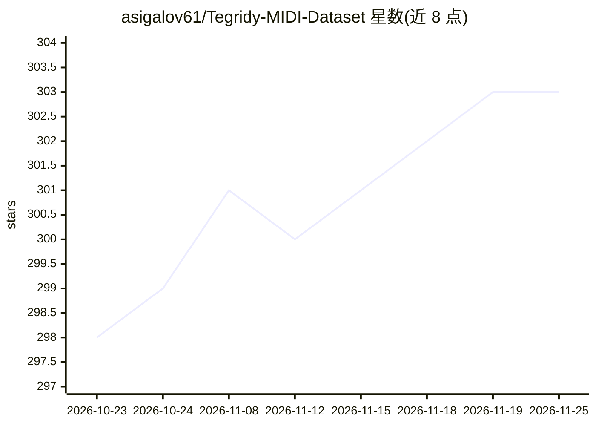

# asigalov61/Tegridy-MIDI-Dataset

⭐ 303 · Python · Apache-2.0 · 推送 2026-11-18 · [GitHub](https://github.com/asigalov61/Tegridy-MIDI-Dataset) · [官网](https://soundcloud.com/aleksandr-sigalov-61/) · 个人维护

**面向 MIR 与音乐 AI 的多乐器 MIDI 数据集与资源目录**

本体是一个符号音乐数据资源仓库：提供多个自建 MIDI 数据集（如 Tegridy Piano、Tegridy Children Songs 等，CC BY-NC-SA 许可），并作为目录页收录数十个外部 MIDI 数据集（Discover、Godzilla、MAESTRO、GiantMIDI、LAKH 等）的链接与说明，另整合 FluidSynth、soundfont、Colab 形式的音乐 AI 工具（audio-to-MIDI、MIDI captioning、生成等）。安装方式为 git clone。面向 MIR 研究者与音乐 AI 模型开发者。

## 筛选速览

| 维度 | 判定 | 备注 |
|---|---|---|
| AI 角色 | `ai-knowledge` | 知识聚合/清单类 |
| 许可风险 | `permissive` | Apache-2.0 |
| 部署形态 | `None` |  |
| 模型依赖 | — | README 未给出锁定关系 |
| 硬件要求 | — | 无带数字的原话,不猜 |
| 安装摩擦 | `low` | 无编译、无系统依赖或容器化 |
| 成熟度 | — | 结构信号不足 |

## 能力要点

- 自建多个多乐器/钢琴主题 MIDI 数据集，CC BY-NC-SA 许可
- 收录 Discover（6.74M）、Godzilla（5.8M）等大规模外部数据集索引
- 附带软件、soundfont 与 Colab 形式的音乐 AI 工具链接

## 适用场景

- 为符号音乐模型训练寻找大规模 MIDI 语料
- 做多乐器、钢琴等特定任务的 MIR 研究
- 查找 audio-to-MIDI、MIDI captioning 等工具

## 场景标签

 · 领域:音乐/数据集

## 证据(README 行号)

> L17: > The Tegridy MIDI Dataset is a comprehensive, multi-instrumental symbolic music resource specifically designed for
> L23: * **Massive, Curated Datasets (e.g., Discover, Godzilla, Meta):** These are enormous collections (often millions of

## 星数曲线

2026-10-23 298 → 2026-11-25 303（+5）

---
*卡片 v1 · prompt 1.4 · 生成 2026-11-25 · 置信度 high · 依据 README sha `016b5eff8bad` · [字段定义](../../DATASET.md)*
