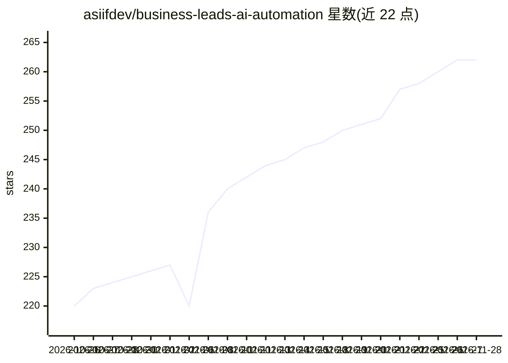

# asiifdev/business-leads-ai-automation

⭐ 262 · TypeScript · AGPL-3.0 · 推送 2026-11-24 · [GitHub](https://github.com/asiifdev/business-leads-ai-automation) · [官网](https://alatpintar.id) · 组织维护

**面向本地商户的 AI 销售营销自动化：找线索、写跟进、人工审批后发送**

名为 Prospex 的开源销售营销自动化系统：用无头浏览器抓取 Google Maps 线索（每活动上限 2,000 条），辅以 Overture Maps、OpenStreetMap 与 CSV 导入；AI 读取用户网站或文档生成营销简报，按评分排序线索，依据知识库与用户语气画像起草 WhatsApp/邮件外联消息。所有草稿进入 Outbox，须经人工批准，按每小时/每日限额逐一发送。技术栈为 Next.js/NestJS/PostgreSQL，AGPL v3 许可，可自托管或使用托管版 alatpintar.id。

## 筛选速览

| 维度 | 判定 | 备注 |
|---|---|---|
| AI 角色 | `ai-native` | 本体是模型或模型工具 |
| 许可风险 | `dual` | AGPL-3.0 |
| 部署形态 | `self-host` | docker 或自建部署 |
| 模型依赖 | local-ok | 支持本地模型 |
| 硬件要求 | — | 无带数字的原话,不猜 |
| 安装摩擦 | `low` | 无编译、无系统依赖或容器化 |
| 成熟度 | — | 结构信号不足 |

## 能力要点

- Google Maps/Overture/OpenStreetMap 多源线索抓取与 0-100 评分
- AI 起草外联消息，Outbox 人工审批后按限额逐一发送
- AI Style 从用户 WhatsApp 导出记录学习写作风格，不存原始聊天
- 回复自动分类并生成跟进草稿，STOP 关键词永久停发

## 适用场景

- 为本地商户批量寻找并打分潜在客户线索
- 以自己的语气批量起草个性化 WhatsApp/邮件外联
- 在管道看板中跟踪回复、跟进与成交状态

## 场景标签

`RAG` `网页抓取` · 领域:效率与自动化

## 证据(README 行号)

> L2:  Open-source AI sales and marketing automation for local businesses.
> L20: Prospex splits the job in two. The AI does the typing: it finds the leads, writes each draft, and drafts the replie
> L32: |**Score**|A 0 to 100 ranking from signals in the listing (reachable by phone, rating weighted by review count, rev

## 星数曲线

2026-10-26 220 → 2026-11-28 262（+42）

---
*卡片 v1 · prompt 1.4 · 生成 2026-11-26 · 置信度 high · 依据 README sha `2e95b6ac9d6a` · [字段定义](../../DATASET.md)*
