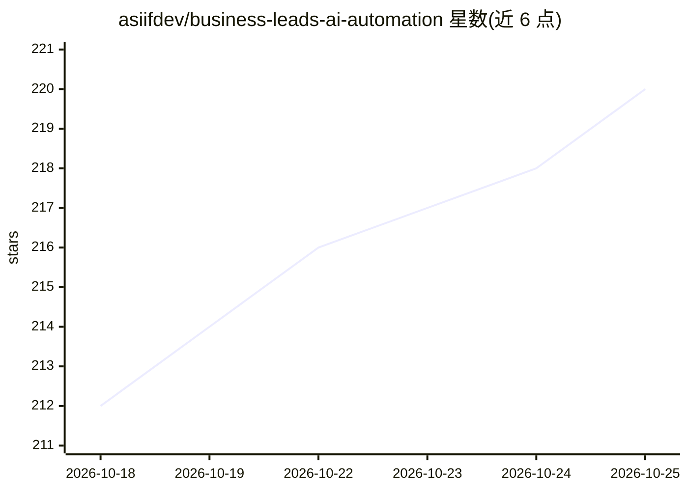

# asiifdev/business-leads-ai-automation

⭐ 220 · TypeScript · AGPL-3.0 · 推送 2026-10-25 · [GitHub](https://github.com/asiifdev/business-leads-ai-automation) · [官网](https://alatpintar.id) · 个人维护

**面向本地商家的开源 AI 销售外联系统：找线索、拟稿、人工审批后发送**

Prospex 是自托管的 AI 销售/营销自动化 Web 应用：用无头浏览器按行业和城市抓取 Google Maps 商家线索（每活动至多 2,000 条，不编造数据），基于评分与 AI 匹配度排序，按用户自己的写作风格（从 WhatsApp 聊天导出学习）起草 WhatsApp/Email 个性化外联，所有草稿进入 Outbox 等人工批准后逐条限速发送（每小时/每日上限、静默时段），并对回复分类、跟进与成交跟踪。技术栈为 Next.js + NestJS + PostgreSQL(pgvector) + Redis/BullMQ，AI 侧支持任意 OpenAI 兼容提供方（OpenAI/OpenRouter/Ollama），AGPL v3 许可，另有托管版 alatpintar.id。

## 筛选速览

| 维度 | 判定 | 备注 |
|---|---|---|
| AI 角色 | `ai-native` | 本体是模型或模型工具 |
| 许可风险 | `dual` | AGPL-3.0 |
| 部署形态 | `self-host` | docker 或自建部署 |
| 模型依赖 | local-ok | 支持本地模型 |
| 硬件要求 | — | 无带数字的原话,不猜 |
| 安装摩擦 | `low` | 无编译、无系统依赖或容器化 |
| 成熟度 | — | 结构信号不足 |

## 能力要点

- Google Maps 无头浏览器抓取线索，每活动至多 2,000 条，抓取失败即如实失败
- AI 从真实数据与用户风格起草个性化 WhatsApp/Email，每条消息须经人工批准
- 发送限速保护机制：每小时 10/每日 80 默认上限、静默时段、STOP 永久屏蔽、熔断器
- AI Style 从 WhatsApp 聊天导出检索式学习写作风格，可本地 Ollama 运行

## 适用场景

- 我想给本地商家做销售外联，让 AI 写初稿但由我逐条把关后再发
- 我需要抓取某城市某行业商家线索并按匹配度排序跟进
- 我想管理外联管线：回复分类、自动跟进草稿、成交与丢单原因追踪

## 场景标签

`网页抓取` `工作流自动化` · 领域:效率与自动化

## 证据(README 行号)

> L3:  Discover business leads, enrich business information, draft personalized outreach with AI, review every message bef
> L113: |**AI**|Any OpenAI-compatible provider: OpenAI, OpenRouter, Ollama|

## 星数曲线

2026-10-18 212 → 2026-10-25 220（+8）

---
*卡片 v1 · prompt 1.4 · 生成 2026-10-22 · 置信度 mid · 依据 README sha `b2dc64d7393d` · [字段定义](../../DATASET.md)*
