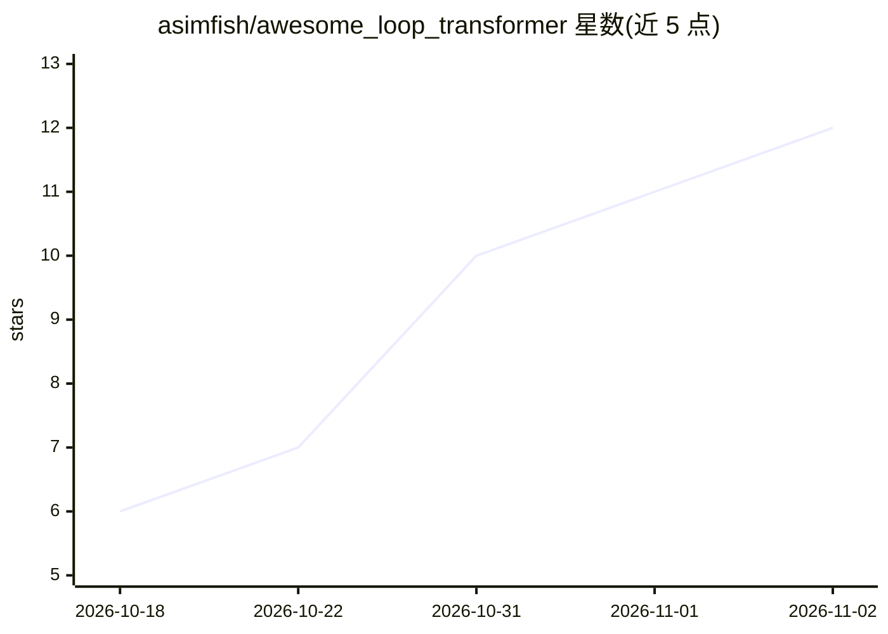

# asimfish/awesome_loop_transformer

⭐ 12 · Python · NOASSERTION · 推送 2026-09-08 · [GitHub](https://github.com/asimfish/awesome_loop_transformer) · 个人维护 · 中文 README

**循环/递归深度 Transformer 论文策展清单与深度解读报告**

围绕 looped / recurrent-depth / weight-tied transformers 及潜在推理主题的论文策展仓库：收录 122 篇论文（2018–2026），按理论、规模化预训练、效率、稳定性、自适应计算等 16 类组织；五篇核心论文（如 Universal Transformers、Huginn 递归深度方法等）配有中英逐篇深度报告、保版式中译 PDF、带十条趋势洞见的综述，以及 HTML/Beamer/PPTX 多格式幻灯片，并提供 CSV/JSON 机器可读论文列表。起始来源为微信文章与 @nrehiew_ 推文串。

## 筛选速览

| 维度 | 判定 | 备注 |
|---|---|---|
| AI 角色 | `ai-knowledge` | 知识聚合/清单类 |
| 许可风险 | `none` | NOASSERTION |
| 部署形态 | `desktop` | 安装包/桌面程序 |
| 模型依赖 | — | README 未给出锁定关系 |
| 硬件要求 | — | 无带数字的原话,不猜 |
| 安装摩擦 | `low` | 无编译、无系统依赖或容器化 |
| 成熟度 | — | 结构信号不足 |

## 能力要点

- 122 篇论文按 16 类组织，覆盖 2018–2026
- 五篇核心论文配中英深度报告与保版式中译 PDF
- 综述含分类法、时间线、~60 篇论文地图与十条趋势洞见
- 提供 HTML/Beamer/PPTX 幻灯片与 papers.csv 等机器可读数据

## 适用场景

- 系统调研循环 Transformer 与潜在推理方向的文献
- 通过中英报告和综述快速掌握该技术脉络
- 获取可直接复用的中英文演讲幻灯片

## 场景标签

`精选清单` `科研工具` · 领域:学习与行业

## 证据(README 行号)

> L5: A curated, annotated list of papers on **looped / recurrent-depth / weight-tied transformers** and the latent-reason
> L9: **中文说明见 README_zh.md。** 五篇核心论文的逐篇深度解读在 `reports/zh/`，保版式中译 PDF 在 `papers/zh/`，趋势综述在 `survey/zh/`，完整中文报告 PDF 见 `repor
> L56:  &emsp;1. Core Papers (5)

## 星数曲线

2026-10-18 6 → 2026-11-02 12（+6）

---
*卡片 v1 · prompt 1.4 · 生成 2026-11-02 · 置信度 high · 依据 README sha `a5a8497a782c` · [字段定义](../../DATASET.md)*
