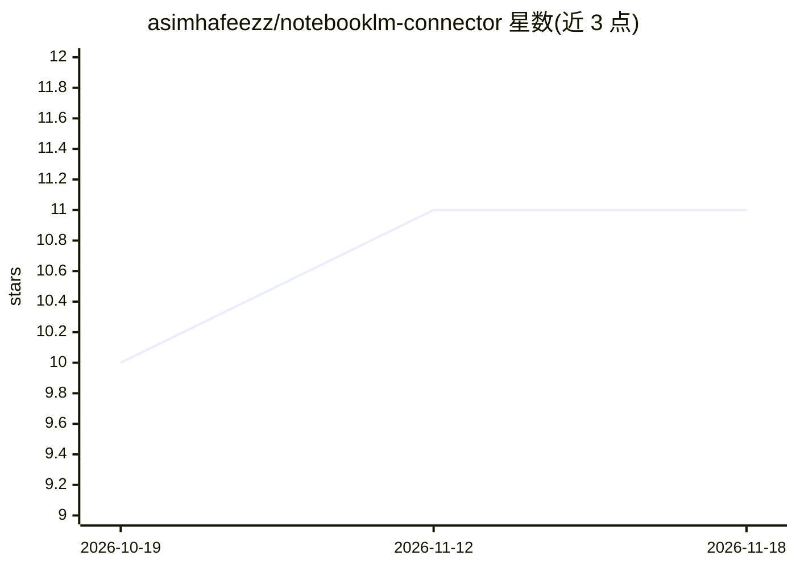

# asimhafeezz/notebooklm-connector

⭐ 11 · Python · MIT · 推送 2026-07-03 · [GitHub](https://github.com/asimhafeezz/notebooklm-connector) · [官网](https://notebooklmconnector.vercel.app) · 个人维护

**让任意 MCP 客户端接入 Google NotebookLM 笔记本问答的服务器**

一个 MCP 服务器，把 Google NotebookLM 接入支持 MCP 的 AI 助手（Claude、Cursor、Codex、Cline 等）。提供 13 个工具：列出/创建笔记本、添加来源（URL/YouTube/文本/文件）、带引用的问答、生成并下载 Studio 内容（音频概览、报告、测验等）。认证复用浏览器已登录的 Google 会话，无需密码；通过 NotebookLM 内部 API 工作，官方 API 不存在，可能因 Google 变更而失效。免费账户每日约 50 次提问配额。

## 筛选速览

| 维度 | 判定 | 备注 |
|---|---|---|
| AI 角色 | `ai-ecosystem` | LLM/agent 周边工具 |
| 许可风险 | `permissive` | MIT |
| 部署形态 | `library` | 以包/库形式分发 |
| 模型依赖 | — | README 未给出锁定关系 |
| 硬件要求 | — | 无带数字的原话,不猜 |
| 安装摩擦 | `low` | 无编译、无系统依赖或容器化 |
| 成熟度 | — | 结构信号不足 |

## 能力要点

- 13 个工具覆盖笔记本管理与来源添加
- 带引用的问答及 auto-coverage 跟进机制（thorough 模式）
- 复用浏览器 Google 会话登录，无需密码
- 提供 Claude Desktop .mcpb 安装包与 uvx 一行接入

## 适用场景

- 在 Claude/Cursor 等助手中直接问答自己的 NotebookLM 笔记本
- 通过对话为笔记本批量添加网页/YouTube 来源
- 从笔记本生成音频概览、测验、报告并保存到本地

## 场景标签

`文档问答` · 领域:知识与检索

## 证据(README 行号)

> L9: Bring your **Google NotebookLM** notebooks into **any AI assistant that speaks MCP** — Claude, Cursor, Codex, Antigr
> L109: Architecture: you → AI assistant → notebooklm-connector (the MCP server, built here) → notebooklm-py → Google Note
> L111: `notebooklm-connector` (this project) is the **MCP server** — the piece your AI assistant talks to and the one tha

## 星数曲线

2026-10-19 10 → 2026-11-18 11（+1）

---
*卡片 v1 · prompt 1.4 · 生成 2026-11-18 · 置信度 mid · 依据 README sha `760e442c97af` · [字段定义](../../DATASET.md)*
