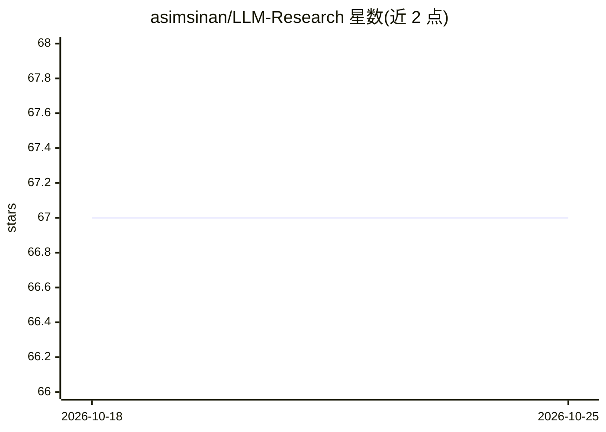

# asimsinan/LLM-Research

⭐ 67 · Python · 推送 2026-08-13 · [GitHub](https://github.com/asimsinan/LLM-Research) · 个人维护

**LLM 论文、学位论文、课程与工具的策展清单**

一个按年份组织的大语言模型论文策展清单，摘要要点由 MBZUAI/LaMini-Flan-T5-248M 模型生成，另收录开放获取学位论文、大学课程以及工具与框架等部分。维护者声明将在新论文发表时更新清单，接受贡献与建议，并计划未来建设网站以自动化维护工作（可能使用基于 LLM 的 Agent）。README 仅列出章节目录，条目内容存于仓库其他文件中。

## 筛选速览

| 维度 | 判定 | 备注 |
|---|---|---|
| AI 角色 | `ai-knowledge` | 知识聚合/清单类 |
| 许可风险 | `none` | — |
| 部署形态 | `None` |  |
| 模型依赖 | — | README 未给出锁定关系 |
| 硬件要求 | — | 无带数字的原话,不猜 |
| 安装摩擦 | `low` | 无编译、无系统依赖或容器化 |
| 成熟度 | — | 结构信号不足 |

## 能力要点

- 按年份组织的 LLM 论文清单
- 摘要要点由 LaMini-Flan-T5-248M 模型生成
- 收录学位论文、大学课程、工具与框架四个板块
- 维护者持续更新并接受社区贡献

## 适用场景

- 按年份追溯 LLM 领域重要论文
- 查找 LLM 相关的开放获取学位论文与大学课程
- 了解 LLM 工具与框架的收录情况

## 场景标签

`精选清单` · 领域:学习与行业

## 证据(README 行号)

> L1: A curated list of papers on Large Language Models by year (Bullet Points were generated by 'MBZUAI/LaMini-Flan-T5-24

## 星数曲线

2026-10-18 67 → 2026-10-25 67（+0）

---
*卡片 v1 · prompt 1.4 · 生成 2026-10-24 · 置信度 high · 依据 README sha `1dd701463c51` · [字段定义](../../DATASET.md)*
