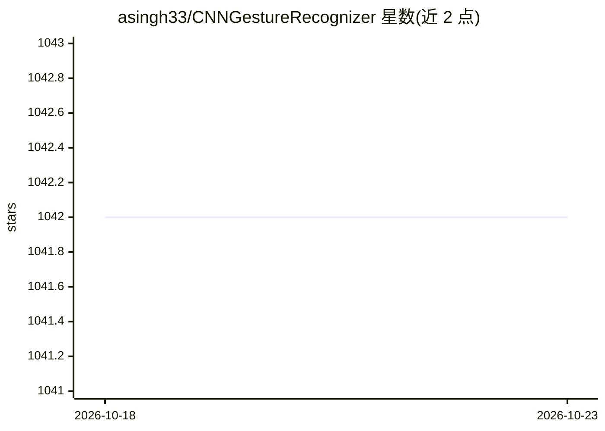

# asingh33/CNNGestureRecognizer

⭐ 1,042 · Python · MIT · 推送 2026-05-21 · [GitHub](https://github.com/asingh33/CNNGestureRecognizer) · 个人维护

**用 CNN 识别手部手势的开发者项目：摄像头输入，5 类手势预测**

基于 Keras + TensorFlow/Theano + OpenCV 的手势识别应用：从摄像头捕获手部图像，经二值化阈值或肤色掩码两种预处理后输入 12 层 CNN（约 3930 万参数），识别 OK/PEACE/STOP/PUNCH/NOTHING 共 5 类手势。内置 4015 张自采训练图像与分平台的预训练权重文件（150MB，托管在 Google Drive），支持重新训练、自定义手势采样、各层特征图可视化，预测数据可输出到控制台或 JSON。提供运行命令而非安装脚本，要求 Python 3.6.1 等指定版本依赖。

## 筛选速览

| 维度 | 判定 | 备注 |
|---|---|---|
| AI 角色 | `ai-native` | 本体是模型或模型工具 |
| 许可风险 | `permissive` | MIT |
| 部署形态 | `None` |  |
| 模型依赖 | — | README 未给出锁定关系 |
| 硬件要求 | — | 无带数字的原话,不猜 |
| 安装摩擦 | `low` | 无编译、无系统依赖或容器化 |
| 成熟度 | — | 结构信号不足 |

## 能力要点

- CNN 模型识别 5 类手势，含背景减除滤波
- Binary 与 SkinMask 两种图像预处理模式
- 支持重训练、自定义手势采样与层级特征图可视化
- 预训练权重 150MB，按 MacOS/Windows 分平台托管于 Google Drive

## 适用场景

- 用摄像头实时识别预定义手势
- 用自己的手势图像样本重训练模型
- 观察 CNN 各层特征图理解网络行为

## 场景标签

`目标检测` · 领域:感知与多模态

## 证据(README 行号)

> L8: Gesture recognition via CNN neural network implemented in Keras + Theano + OpenCV
> L56: This application comes with CNN model to recognize upto 5 pretrained gestures:
> L64: - Prediction : Which allows the app to guess the user's gesture against pretrained gestures. App can dump the predi

## 星数曲线

2026-10-18 1,042 → 2026-10-23 1,042（+0）

---
*卡片 v1 · prompt 1.4 · 生成 2026-10-21 · 置信度 high · 依据 README sha `8e642efa799c` · [字段定义](../../DATASET.md)*
