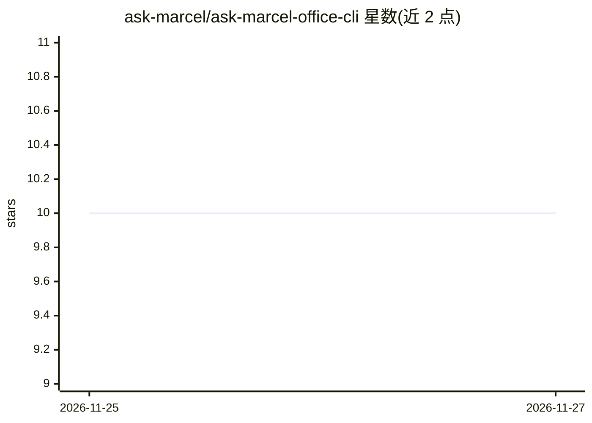

# ask-marcel/ask-marcel-office-cli

⭐ 10 · TypeScript · MIT · 推送 2026-11-26 · [GitHub](https://github.com/ask-marcel/ask-marcel-office-cli) · [官网](https://www.npmjs.com/package/ask-marcel-office-cli) · 个人维护

**为 AI agent 提供只读访问 Microsoft 365 数据的命令行与 MCP 服务器**

由三个 npm 包组成的 Microsoft 365 命令行工具集：office-auth 负责一次性浏览器登录并维护令牌缓存，office-read 提供对邮件、日历、OneDrive、SharePoint、Teams、Excel、OneNote、Planner 等的只读访问并将文档与邮件转为 markdown，office-write 仅写草稿且带 dry-run 与 undo。每个包含独立 bin、MCP 服务器与库。面向 Claude Code、Cursor、Cline 等 agent host；无需 Azure 应用注册或租户管理员同意。包尚未正式发布到 npm，2.8.0 的 bin 已被拆分替代。

## 筛选速览

| 维度 | 判定 | 备注 |
|---|---|---|
| AI 角色 | `ai-ecosystem` | LLM/agent 周边工具 |
| 许可风险 | `permissive` | MIT |
| 部署形态 | `library` | 以包/库形式分发 |
| 模型依赖 | — | README 未给出锁定关系 |
| 硬件要求 | — | 无带数字的原话,不猜 |
| 安装摩擦 | `low` | 无编译、无系统依赖或容器化 |
| 成熟度 | `idea` | |

## 能力要点

- 182 条只读命令覆盖 Outlook/OneDrive/SharePoint/Teams/Excel 等 10 类服务
- Office 文件、PDF 与邮件统一转换为干净的 markdown 供 agent 读取
- 每个包自带 MCP 服务器与 agent skill（复制到 ~/.claude/skills/ 使用）
- 写操作仅限草稿，每项变更提供 dry-run 与 undo

## 适用场景

- 让 Claude Code 或 Cursor 等工具调用 agent 读取我的邮件与日历
- 把 SharePoint 或 OneDrive 文档转成 markdown 供 agent 分析
- 让 agent 代拟邮件草稿但不实际发送

## 场景标签

`文档解析` · 领域:知识与检索

## 证据(README 行号)

> L11: ask-marcel-office gives a tool-calling agent (Claude Code, Cursor, Cline, an MCP
> L17: The project is three npm packages. Each package has its own bin, its own MCP

## 星数曲线

2026-11-25 10 → 2026-11-27 10（+0）

---
*卡片 v1 · prompt 1.4 · 生成 2026-11-24 · 置信度 high · 依据 README sha `54e429b62998` · [字段定义](../../DATASET.md)*
