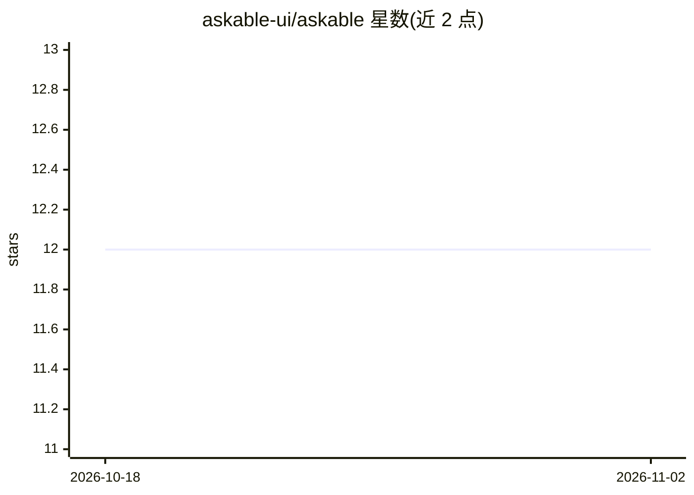

# askable-ui/askable

⭐ 12 · TypeScript · MIT · 推送 2026-10-27 · [GitHub](https://github.com/askable-ui/askable) · [官网](https://askable-ui.com) · 组织维护

**前端 UI 上下文捕获库：把用户所见转为 LLM 实时结构化上下文**

面向 Web 开发者的前端库：通过 data-askable 属性或 Askable 组件标注现有界面元素，在点击、悬停、聚焦等交互时自动生成描述当前用户所见（焦点指标、可见元素、导航历史）的结构化 promptContext 字符串，可传给任意 LLM SDK；另提供 MCP 服务器（askable-mcp 二进制与 @askable-ui/mcp 包）把上下文以工具和资源形式暴露给 Claude Desktop、Cursor 等 MCP 客户端，以及 bridge 传输层将上下文包发送至自建聊天 UI、iframe、扩展或 webhook。支持 React/Vue/Svelte/SolidJS/Angular/Qwik，含区域圈选、文本选区、视口、多轮对话、Cmd+K 触发等能力。

## 筛选速览

| 维度 | 判定 | 备注 |
|---|---|---|
| AI 角色 | `ai-ecosystem` | LLM/agent 周边工具 |
| 许可风险 | `permissive` | MIT |
| 部署形态 | `library` | 以包/库形式分发 |
| 模型依赖 | — | README 未给出锁定关系 |
| 硬件要求 | — | 无带数字的原话,不猜 |
| 安装摩擦 | `low` | 无编译、无系统依赖或容器化 |
| 成熟度 | — | 结构信号不足 |

## 能力要点

- Askable 组件标注后自动生成含焦点/可见元素/导航历史的 promptContext
- askable-mcp 将上下文以 MCP 工具与 askable://current 资源暴露给任意 MCP 客户端
- bridge 提供函数/PostMessage/浏览器扩展/HTTP 等传输方式投递上下文包
- 区域/套索圈选、文本选区、视口、表单/表格/购物车等 30+ 上下文源钩子

## 适用场景

- 给数据看板的 AI 助手实时提供用户正在看的指标上下文
- 让 Claude Desktop 或 Cursor 通过 MCP 读取 Web 应用当前状态
- 在自建聊天 UI、iframe 或浏览器扩展中注入页面上下文

## 场景标签

 · 领域:LLM 应用开发/前端工具

## 证据(README 行号)

> L6:  <code>data-askable</code> turns what the user is looking at into structured, real-time context — for every LLM SDK 
> L93: **Give Claude eyes into your running app in one command.** If your app exposes its current context at an endpoint (
> L119: Not every assistant is an MCP client. `@askable-ui/bridge` moves the same Context packet to wherever the user actu

## 星数曲线

2026-10-18 12 → 2026-11-02 12（+0）

---
*卡片 v1 · prompt 1.4 · 生成 2026-11-01 · 置信度 high · 依据 README sha `7fb55de2397b` · [字段定义](../../DATASET.md)*
