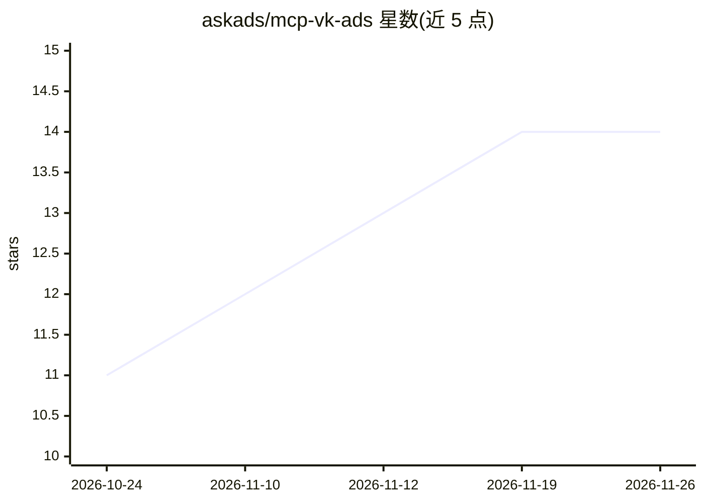

# askads/mcp-vk-ads

⭐ 14 · TypeScript · MIT · 推送 2026-11-21 · [GitHub](https://github.com/askads/mcp-vk-ads) · [官网](https://www.npmjs.com/package/mcp-vk-ads) · 组织维护

**把 VK Ads 广告账户接入 AI 应用的 MCP 服务器**

通过 MCP 协议将 AI 应用（Claude Code/Claude Desktop/Cursor/Codex/VS Code）连接到 VK Ads 广告后台，提供 22 个工具覆盖广告系列、广告组、广告、出价、统计、余额与 API 限额。查询类操作只读，创建/更新/状态变更直接作用于真实账户（VK Ads 无沙箱）。通过对话引导获取 client_id/client_secret 完成授权，refresh_token 自动续期，凭据以 0600 权限存于本地配置文件。需 Node.js 20+，经 npx 运行无需单独安装。

## 筛选速览

| 维度 | 判定 | 备注 |
|---|---|---|
| AI 角色 | `ai-ecosystem` | LLM/agent 周边工具 |
| 许可风险 | `permissive` | MIT |
| 部署形态 | `library` | 以包/库形式分发 |
| 模型依赖 | — | README 未给出锁定关系 |
| 硬件要求 | — | 无带数字的原话,不猜 |
| 安装摩擦 | `low` | 无编译、无系统依赖或容器化 |
| 成熟度 | — | 结构信号不足 |

## 能力要点

- 22 个工具覆盖广告系列→组→广告完整层级及统计/余额/限额
- 对话式账户连接，token 自动续期，凭据本地 0600 存储
- 读操作只读，写操作需确认机制，raw_request 写操作要求 confirmWrite=true
- 自动翻页上限 1000 条并标记 _truncated，429/5xx 自动重试

## 适用场景

- 让 AI 助手分析哪些广告系列花钱无效果并对比组间数据
- 对话式创建广告系列、修改日预算、暂停广告
- 查询账户余额、API 剩余额度、地区 ID 等配置数据
- 排查广告未展示的投放与审核状态原因

## 场景标签

 · 领域:广告营销/API 工具

## 证据(README 行号)

> L8: **VK Реклама MCP** подключает AI-приложение к рекламному кабинету VK Ads. Можно спросить, какие кампании тратят бюдж
> L10: - **22 инструмента.** Кампании, группы, объявления, статистика, баланс, лимиты API, регионы, подключение кабинета и

## 星数曲线

2026-10-24 11 → 2026-11-26 14（+3）

---
*卡片 v1 · prompt 1.4 · 生成 2026-11-18 · 置信度 mid · 依据 README sha `16ef055454d0` · [字段定义](../../DATASET.md)*
