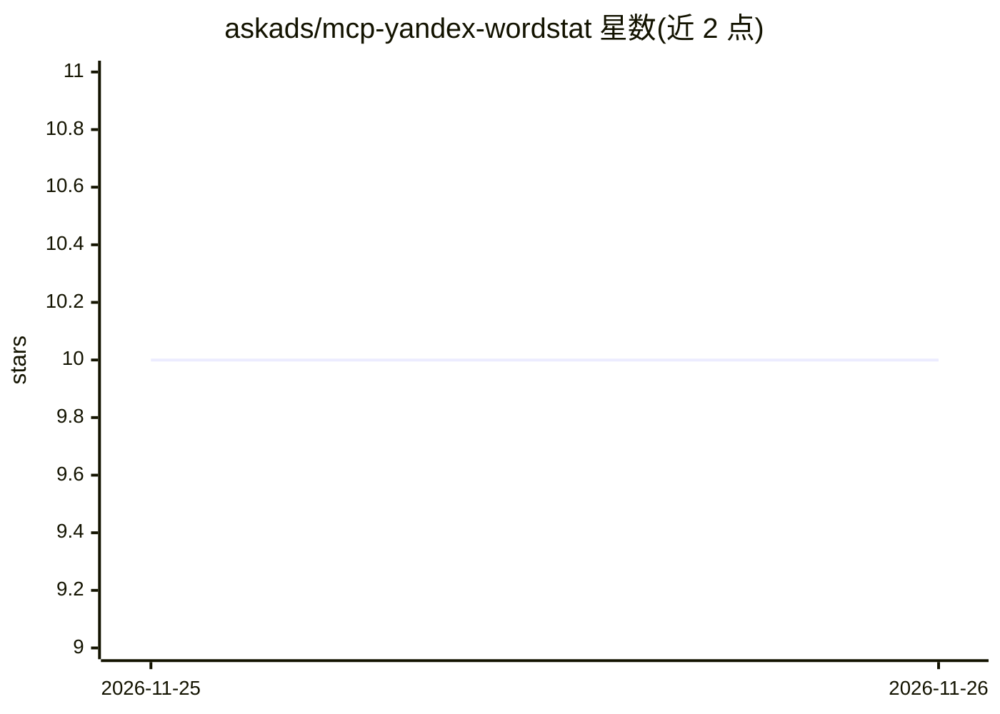

# askads/mcp-yandex-wordstat

⭐ 10 · TypeScript · MIT · 推送 2026-11-21 · [GitHub](https://github.com/askads/mcp-yandex-wordstat) · [官网](https://www.npmjs.com/package/mcp-yandex-wordstat) · 组织维护

**把 Yandex Wordstat 搜索需求数据接入 AI 应用的 MCP 服务器**

通过 MCP 协议向 Claude、Cursor、Codex、VS Code 等 AI 应用提供 Yandex Wordstat 数据的只读服务器，包含五个工具：热门与相似查询、需求动态、地区分布、地区目录及原始 API 请求。数据经 Yandex Cloud Search API v2 获取，不依赖广告账户 OAuth。需 Node.js 20+、Yandex Cloud API 密钥与目录 ID；单次调用仅处理一个短语，配额与云账户共享，默认发送匿名遥测，可用环境变量关闭。

## 筛选速览

| 维度 | 判定 | 备注 |
|---|---|---|
| AI 角色 | `ai-ecosystem` | LLM/agent 周边工具 |
| 许可风险 | `permissive` | MIT |
| 部署形态 | `library` | 以包/库形式分发 |
| 模型依赖 | — | README 未给出锁定关系 |
| 硬件要求 | — | 无带数字的原话,不猜 |
| 安装摩擦 | `low` | 无编译、无系统依赖或容器化 |
| 成熟度 | — | 结构信号不足 |

## 能力要点

- 五个只读工具：热门/相似查询、需求动态、地区分布、地区目录、原始 API 请求
- 支持按日/周/月的季节性趋势与按地区、设备类型细分
- 无需广告账户 OAuth，仅使用 Yandex Cloud Search API 密钥
- 提供 Claude Code/Claude Desktop/Cursor/Codex/VS Code 五种客户端接入配置

## 适用场景

- 查询关键词的月度搜索量并获取相似查询
- 分析某个词一年内各月的需求季节性变化
- 对比不同城市或设备上的搜索需求差异

## 场景标签

`数据分析` · 领域:效率与自动化

## 证据(README 行号)

> L8: **Яндекс Вордстат MCP** подключает AI-приложение к статистике поискового спроса Яндекса. Спросите, как часто ищут фр
> L34: 1. Получите доступ и добавьте сервер в AI-приложение — инструкции для пяти приложений ниже.
> L155: Сервер обращается к Yandex Cloud Search API v2. Старый отдельный Wordstat API с OAuth не используется. API-ключ хр

## 星数曲线

2026-11-25 10 → 2026-11-26 10（+0）

---
*卡片 v1 · prompt 1.4 · 生成 2026-11-24 · 置信度 high · 依据 README sha `4e8705840967` · [字段定义](../../DATASET.md)*
