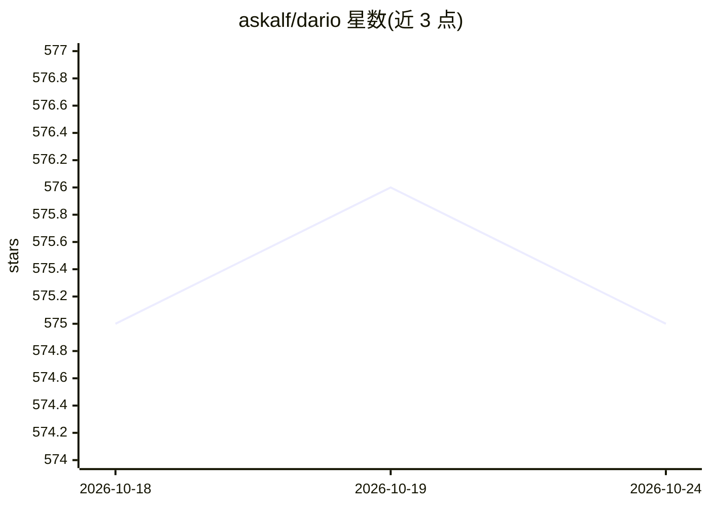

# askalf/dario

⭐ 575 · JavaScript · MIT · 推送 2026-10-24 · [GitHub](https://github.com/askalf/dario) · [官网](https://www.npmjs.com/package/@askalf/dario) · 个人维护

**本地代理网关：让 AI 工具复用 Claude/ChatGPT 订阅**

运行在本机的单一端点代理（localhost:3456）：把 Claude Code、Cursor、Cline、Aider、Codex CLI 及各类 SDK 的请求转发到用户已有的 Claude 或 ChatGPT 订阅，在 Anthropic Messages 与 OpenAI Chat 协议间做翻译，429 时在两个订阅间故障转移，支持多席位池化、命名密钥与预算、用量账本。0 运行时依赖，npm 全局安装，也有多架构 Docker 镜像。README 明示为非官方第三方项目，并含账号可能被处置的风险讨论。

## 筛选速览

| 维度 | 判定 | 备注 |
|---|---|---|
| AI 角色 | `ai-ecosystem` | LLM/agent 周边工具 |
| 许可风险 | `permissive` | MIT |
| 部署形态 | `library` | 以包/库形式分发 |
| 模型依赖 | locked-api |  |
| 硬件要求 | — | 无带数字的原话,不猜 |
| 安装摩擦 | `low` | 无编译、无系统依赖或容器化 |
| 成熟度 | — | 结构信号不足 |

## 能力要点

- 单端点路由多种 AI 工具至已有订阅，Anthropic/OpenAI 协议互译
- 429 时跨订阅故障转移，流式中断可在同模型上续完
- 多席位池化路由、命名密钥、按 API 价计价的用量账本
- 0 运行时依赖，SLSA 证明发布，无遥测，默认仅绑定 127.0.0.1

## 适用场景

- 让 Cursor/Aider/Cline 等工具直接用我已付费的订阅，避免按 token 再付费
- 多个订阅席位间做池化与故障转移
- 团队内按开发者分发带预算限制的命名密钥

## 场景标签

`模型网关` · 领域:Agent 开发

## 证据(README 行号)

> L1: dario routes every AI tool you use to the subscriptions you already pay for. Claude Code, Cursor, Cline, Aider, Code
> L31: **dario is one local endpoint that routes all of them through the plans you already pay for.** Point any Anthropic-
> L65: You point every tool at one URL. dario reads each request, decides which plan or backend owns it, and forwards it i

## 星数曲线

2026-10-18 575 → 2026-10-24 575（+0）

---
*卡片 v1 · prompt 1.4 · 生成 2026-10-21 · 置信度 high · 依据 README sha `d80115c09048` · [字段定义](../../DATASET.md)*
