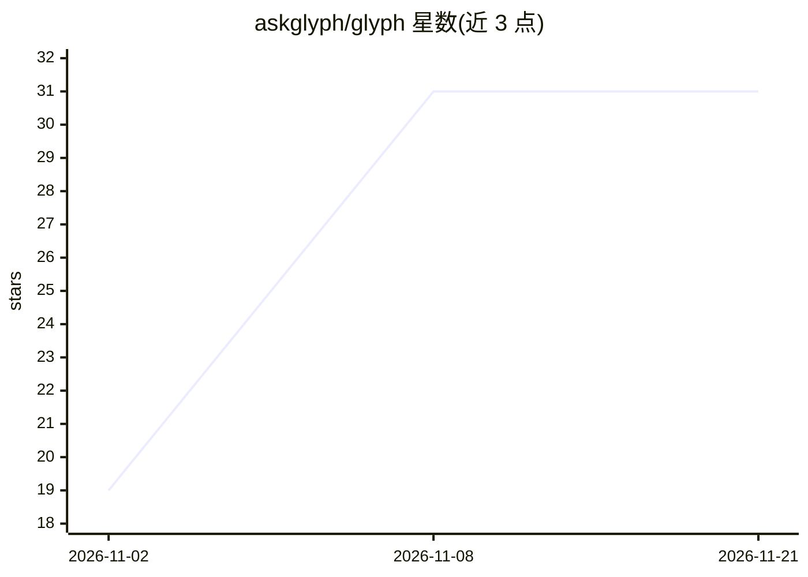

# askglyph/glyph

⭐ 31 · TypeScript · MIT · 推送 2026-11-02 · [GitHub](https://github.com/askglyph/glyph) · [官网](https://askglyph.chat) · 个人维护

**对话式 ASCII 魔魟 agent：运营 $GLYPH 代币储备并铸造压缩 NFT 卡**

部署在 Solana 上的对话式角色应用：用户在聊天窗口与 ASCII 魔魟 glyph 对话，完成 X 平台任务（关注/点赞/转发/引用）、听取 pitch 并获得待分配额度，按需铸造 Metaplex Bubblegum v2 压缩 NFT 卡至钱包。语言模型仅提议工具调用，数值由固定 SQL 函数与幂等键决定；模型不可用时降级为脚本化大脑。技术栈为 Vite+TypeScript 前端、Netlify Functions、Postgres（RPC+RLS）、X OAuth 2.0，卡片图由服务端 SVG→PNG 生成。

## 筛选速览

| 维度 | 判定 | 备注 |
|---|---|---|
| AI 角色 | `ai-native` | 本体是模型或模型工具 |
| 许可风险 | `permissive` | MIT |
| 部署形态 | `library` | 以包/库形式分发 |
| 模型依赖 | — | README 未给出锁定关系 |
| 硬件要求 | — | 无带数字的原话,不猜 |
| 安装摩擦 | `low` | 无编译、无系统依赖或容器化 |
| 成熟度 | — | 结构信号不足 |

## 能力要点

- 语言模型只能提议工具调用，奖励数值由固定 SQL 函数与幂等键决定
- 模型端点不可用时降级为脚本化大脑，使用相同工具
- 按需铸造 Bubblegum v2 压缩 NFT，签名先于广播存储防止重复铸造
- X OAuth 2.0 + PKCE 登录，HMAC 会话 cookie，读取后即撤销 X token

## 适用场景

- 在聊天中完成 X 任务并领取压缩 NFT 卡
- 通过对话 pitch 争取更多分配额度
- 作为对话式 agent + 链上奖励的参考实现自行部署

## 场景标签

`聊天机器人` · 领域:对话与助手

## 证据(README 行号)

> L25: glyph is a conversational agent with a body: an ASCII manta rendered live in your browser, gliding through a field 
> L91: |Mind|a language model behind an OpenAI-compatible endpoint, with a scripted brain as fallback|

## 星数曲线

2026-11-02 19 → 2026-11-21 31（+12）

---
*卡片 v1 · prompt 1.4 · 生成 2026-11-18 · 置信度 high · 依据 README sha `e1733c32e902` · [字段定义](../../DATASET.md)*
