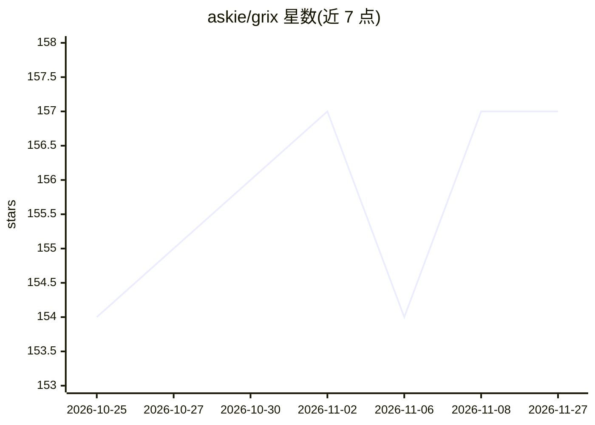

# askie/grix

⭐ 157 · Go · NOASSERTION · 推送 2026-11-24 · [GitHub](https://github.com/askie/grix) · [官网](https://grix.im/) · 组织维护 · 中文 README

**让用户像聊天一样与 AI 编码代理协作的跨平台即时通讯应用**

跨平台协作与即时通讯应用，将 Claude、Codex、DeepSeek 等 15 种编码代理/助手添加为联系人，支持私聊、群组、@提及、任务分配与进度跟踪；代理在会话上下文中持续工作并主动汇报，用户可随时添加指令、暂停或接管。覆盖 iOS/iPadOS/Apple Watch/Android/Windows/macOS/Linux/Web，提供 Go 后端、Flutter 客户端与管理端、语音桥接服务与 K8s 部署清单。仓库为 source-available 许可。

## 筛选速览

| 维度 | 判定 | 备注 |
|---|---|---|
| AI 角色 | `ai-ecosystem` | LLM/agent 周边工具 |
| 许可风险 | `none` | NOASSERTION |
| 部署形态 | `None` |  |
| 模型依赖 | — | README 未给出锁定关系 |
| 硬件要求 | — | 无带数字的原话,不猜 |
| 安装摩擦 | `low` | 无编译、无系统依赖或容器化 |
| 成熟度 | — | 结构信号不足 |

## 能力要点

- 支持 15 种主流代理，并提供 ACP 兼容 CLI 与 WebSocket 协议两条自定义接入路径
- 桌面发起任务、手机/手表审批跟进的跨设备统一会话线程
- 权限范围、角色隔离与人随时接管的安全控制机制
- 含 Go 后端、Flutter 客户端/管理端、Python 语音桥接与 K8s 部署示例

## 适用场景

- 把开发、测试、文档、发布任务分配给不同代理并在项目群里协调
- 出差路上通过手机或手表审批代理的阻塞项
- 让客服代理先应答常见问题，再带着上下文转接人工
- 将产品、工程、QA 与代理拉入同一群组共享上下文

## 场景标签

`编码 Agent` · 领域:编码与开发

## 证据(README 行号)

> L9: Grix is a cross-platform collaboration and instant messaging app for coding agents and AI assistants. Like WeChat or
> L55: Grix currently supports 15 popular agents, plus two open paths for bringing your own. Start with any agent you alre
> L70: - **Agent Client Protocol** — any ACP-compatible CLI, connected with `client_type: acp`; the connector spawns it fr

## 星数曲线

2026-10-25 154 → 2026-11-27 157（+3）

---
*卡片 v1 · prompt 1.4 · 生成 2026-11-27 · 置信度 high · 依据 README sha `8ce7c7359f81` · [字段定义](../../DATASET.md)*
