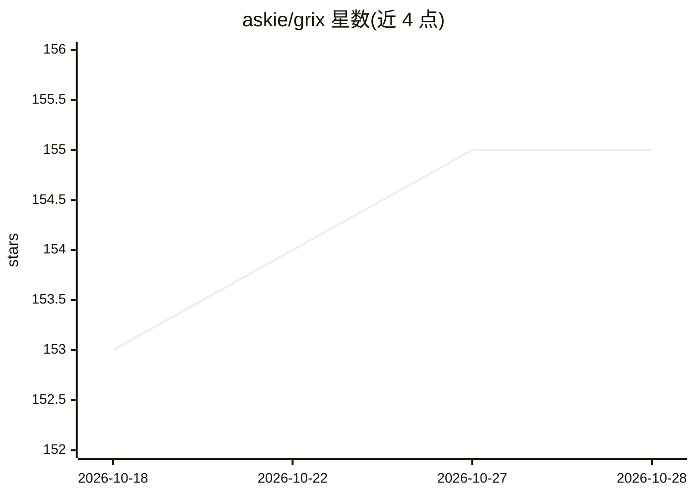

# askie/grix

⭐ 155 · Go · NOASSERTION · 推送 2026-10-26 · [GitHub](https://github.com/askie/grix) · [官网](https://grix.im/) · 组织维护 · 中文 README

**跨平台即时通讯应用：把编码 agent 当联系人沟通协作**

面向使用编码 agent 与 AI 助手的个人与团队的即时通讯与协作应用，覆盖 iOS/iPadOS、Apple Watch、Android、Windows、macOS、Linux 与 Web。将 Claude、Codex、DeepSeek 等 15 个 agent 添加为联系人，支持私聊、拉群、@分派任务、追踪进度、暂停或人工接管；另可通过 ACP 协议或 WebSocket 协议接入自有 agent。仓库含 Go 后端、Flutter 客户端、管理端、语音桥接服务与 k8s 部署示例。采用源码可用许可（Grix Source-Available License 1.0）。

## 筛选速览

| 维度 | 判定 | 备注 |
|---|---|---|
| AI 角色 | `ai-ecosystem` | LLM/agent 周边工具 |
| 许可风险 | `none` | NOASSERTION |
| 部署形态 | `None` |  |
| 模型依赖 | — | README 未给出锁定关系 |
| 硬件要求 | — | 无带数字的原话,不猜 |
| 安装摩擦 | `low` | 无编译、无系统依赖或容器化 |
| 成熟度 | — | 结构信号不足 |

## 能力要点

- 15 个 agent 可作为联系人私聊、入群、@分派任务并追踪进度
- 跨平台：iOS/iPadOS/Apple Watch/Android/Windows/macOS/Linux/Web，统一会话线程
- 两种自有 agent 接入路径：ACP 兼容 CLI 与 WebSocket agent 协议
- 权限范围、角色隔离与 agent 间对话需授权的访问控制机制

## 适用场景

- 把开发、测试、文档等任务分派给不同 agent 并在手机上跟进进度
- 人与 agent 在同一群组中协作，保留需求与决策上下文
- 连接语音模型让 agent 接听来电、收集信息后转交人工

## 场景标签

`编码 Agent` `聊天机器人` `多智能体` · 领域:Agent 开发

## 证据(README 行号)

> L9: Grix is a cross-platform collaboration and instant messaging app for coding agents and AI assistants. Like WeChat or
> L13: Add Claude, Codex, DeepSeek, Kimi, Cursor, and other agents as contacts. Message them privately, invite them to gro
> L65: - **Agent Client Protocol** — any ACP-compatible CLI, connected with `client_type: acp`; the connector spawns it fr

## 星数曲线

2026-10-18 153 → 2026-10-28 155（+2）

---
*卡片 v1 · prompt 1.4 · 生成 2026-10-22 · 置信度 high · 依据 README sha `a99f52270b9d` · [字段定义](../../DATASET.md)*
