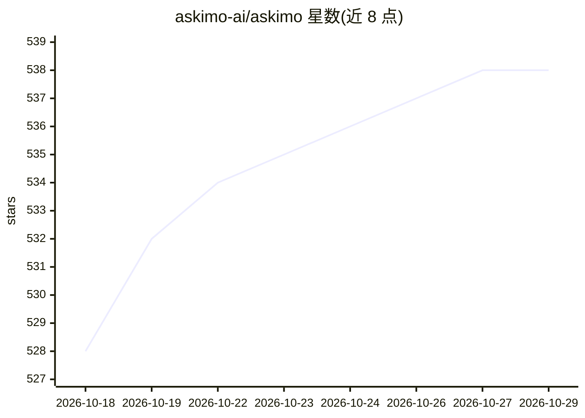

# askimo-ai/askimo

⭐ 538 · Kotlin · AGPL-3.0 · 推送 2026-10-28 · [GitHub](https://github.com/askimo-ai/askimo) · [官网](https://askimo.chat) · 组织维护 · 中文 README

**桌面 AI 工具箱：多模型聊天、本地 RAG、技能与 Agent 委派**

Compose Multiplatform 构建的桌面应用（macOS/Windows/Linux），面向终端用户：单应用内接入 OpenAI、Claude、Gemini、Grok、Ollama、vLLM Server 等多家模型并按会话切换；提供本地 RAG（BM25+向量混合检索，数据不离开本机）、多步骤 Plans 工作流、Python/Bash/JS 脚本执行、MCP 工具接入，并可把任务委派给 Claude Code 等 Agent CLI。内置技能可复用于各 Agent。语音方面支持 whisper.cpp 本地语音转文字与 Piper 本地 TTS。会话存本地 SQLite，桌面安装包直接下载，源码构建需 JDK 25+。

## 筛选速览

| 维度 | 判定 | 备注 |
|---|---|---|
| AI 角色 | `ai-native` | 本体是模型或模型工具 |
| 许可风险 | `viral` | AGPL-3.0 |
| 部署形态 | `None` |  |
| 模型依赖 | local-ok | 支持本地模型 |
| 硬件要求 | — | 无带数字的原话,不猜 |
| 安装摩擦 | `medium` | 含编译或系统依赖之一 |
| 成熟度 | — | 结构信号不足 |

## 能力要点

- 多 provider 接入（OpenAI/Claude/Gemini/Grok/Ollama/LMStudio/vLLM/OpenAI 兼容端点等），按会话切换
- 本地 RAG：BM25+向量混合检索，文件与索引不上传
- 委派任务给 Claude Code、Codex、Antigravity 等 Agent CLI，技能跨 Agent 复用
- 本地语音：whisper.cpp 语音转文字与 Piper TTS，可离线运行

## 适用场景

- 在一个桌面应用里用多家模型聊天，替代多个网页标签
- 对本地文件夹建 RAG 索引后检索与问答，数据不出本机
- 把目标委派给 Claude Code 等 Agent CLI 并实时查看执行过程
- 离线环境下用本地模型与本地语音功能完成对话和听写

## 场景标签

`AI 助手` `文档问答` · 领域:对话与助手

## 证据(README 行号)

> L5:  Chat · Search your files and the web · Run scripts · Build multi-step AI workflows · Execute AI agent skills - all 
> L54: - **One app, every model.** Stop juggling browser tabs. Chat with OpenAI, Claude, Gemini, Grok, or a local Ollama m
> L61: > 🔒 **Privacy by design.** Your files, RAG index, conversation history, and telemetry all stay on your machine, not

## 星数曲线

2026-10-18 528 → 2026-10-29 538（+10）

---
*卡片 v1 · prompt 1.4 · 生成 2026-10-21 · 置信度 high · 依据 README sha `f6d8653472a5` · [字段定义](../../DATASET.md)*
