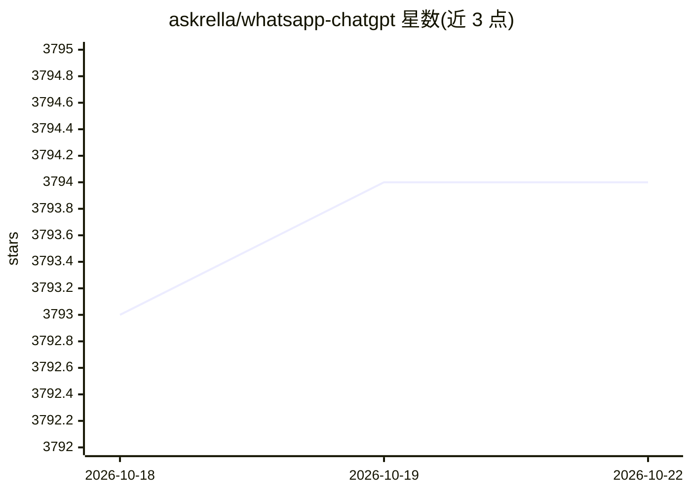

# askrella/whatsapp-chatgpt

⭐ 3,794 · TypeScript · 推送 2026-07-12 · [GitHub](https://github.com/askrella/whatsapp-chatgpt) · 组织维护

**通过 WhatsApp 对话使用 GPT 与 DALL-E 的聊天机器人**

基于 Node.js 的 WhatsApp 机器人，通过 OpenAI API 接入 GPT 回复用户消息并调用 DALL-E 2 生成图像，支持语音消息（转写后回复），转写依赖外部 speech-rest-api 服务。运行需要 Node.js 18+、npm、OpenAI API key 与 WhatsApp 账号；通过 Puppeteer 驱动 WhatsApp Web 实例工作，README 声明该项目已无人维护并寻找维护者，且存在被 WhatsApp 封号风险，每次请求由 OpenAI 计费。安装配置细节见外部文档站。

## 筛选速览

| 维度 | 判定 | 备注 |
|---|---|---|
| AI 角色 | `ai-native` | 本体是模型或模型工具 |
| 许可风险 | `permissive` | — |
| 部署形态 | `None` |  |
| 模型依赖 | — | README 未给出锁定关系 |
| 硬件要求 | — | 无带数字的原话,不猜 |
| 安装摩擦 | `low` | 无编译、无系统依赖或容器化 |
| 成熟度 | — | 结构信号不足 |

## 能力要点

- 通过 WhatsApp 消息与 GPT 对话并获取回复
- 调用 DALL-E 2 生成图像
- 支持语音消息转写后回复
- 基于 Puppeteer 运行 WhatsApp Web 实例

## 适用场景

- 在 WhatsApp 里与 ChatGPT 对话获取回答
- 通过消息让机器人生成 AI 图像
- 用语音消息与 AI 助手交互

## 场景标签

`聊天机器人` `图像生成` `语音识别` · 领域:对话与助手

## 证据(README 行号)

> L9: This WhatsApp bot uses OpenAI's GPT and DALL-E 2 to respond to user inputs.
> L11: You can talk to the bot in voice messages, the bot will transcribe and respond. :robot:

## 星数曲线

2026-10-18 3,793 → 2026-10-22 3,794（+1）

---
*卡片 v1 · prompt 1.4 · 生成 2026-10-20 · 置信度 high · 依据 README sha `317f2258a588` · [字段定义](../../DATASET.md)*
