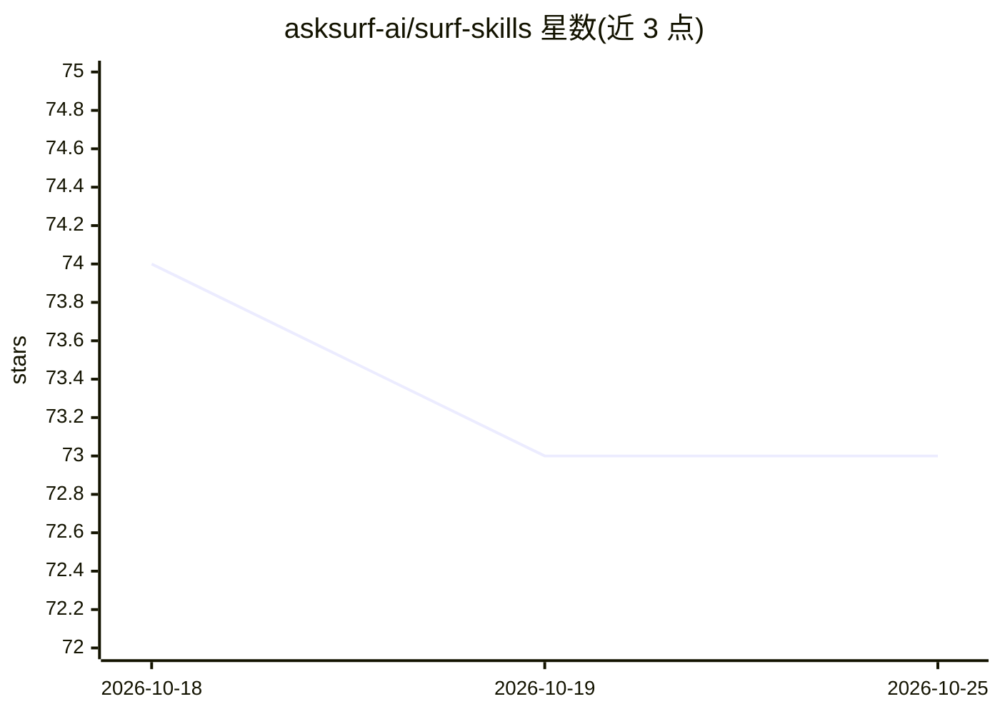

# asksurf-ai/surf-skills

⭐ 73 · 推送 2026-07-27 · [GitHub](https://github.com/asksurf-ai/surf-skills) · [官网](https://skills.sh/asksurf-ai/surf-skills/surf) · 组织维护

**让 AI agent 查询加密市场与链上数据的技能包（83+ 端点）**

面向支持 skills 协议的 AI 编码 agent（Claude Code、Codex 等）的技能包：通过 npx skills add 安装一个 SKILL.md 指令文件，教会 agent 调用 surf CLI 发现并访问 Surf 数据平台的加密行情、钱包、链上、预测市场等 10 个数据域。底层依赖 Surf CLI，无 API key 可用每日 30 次免费额度，配 key 获完整访问；上游新增端点时经 OpenAPI spec 自动同步，无需改本仓库。

## 筛选速览

| 维度 | 判定 | 备注 |
|---|---|---|
| AI 角色 | `ai-ecosystem` | LLM/agent 周边工具 |
| 许可风险 | `none` | — |
| 部署形态 | `library` | 以包/库形式分发 |
| 模型依赖 | — | README 未给出锁定关系 |
| 硬件要求 | — | 无带数字的原话,不猜 |
| 安装摩擦 | `low` | 无编译、无系统依赖或容器化 |
| 成熟度 | — | 结构信号不足 |

## 能力要点

- 单个技能覆盖 10 个数据域、40+ 区块链、200+ 数据源
- SKILL.md 指令文件教 agent 自主发现端点与参数并返回结构化数据
- 无需 API key 即可开始（每日 30 次免费额度）
- 上游新增端点经 OpenAPI spec 自动同步，无需修改仓库

## 适用场景

- 让我的 Claude Code/Codex agent 直接回答 ETH 价格、钱包持仓、TVL 等加密数据问题
- 查询 Polymarket/Kalshi 预测市场行情
- 对链上交易做 SQL 查询与钱包情报分析

## 场景标签

`数据分析` · 领域:效率与自动化

## 证据(README 行号)

> L10: npx skills add asksurf-ai/surf-skills --skill surf
> L13: Works with any agent that supports the skills protocol — Claude Code, Codex, and more.
> L76: The skill (`skills/surf/SKILL.md`) is an instruction file that teaches your AI agent to:

## 星数曲线

2026-10-18 74 → 2026-10-25 73（-1）

---
*卡片 v1 · prompt 1.4 · 生成 2026-10-24 · 置信度 high · 依据 README sha `667d07d2c9c7` · [字段定义](../../DATASET.md)*
