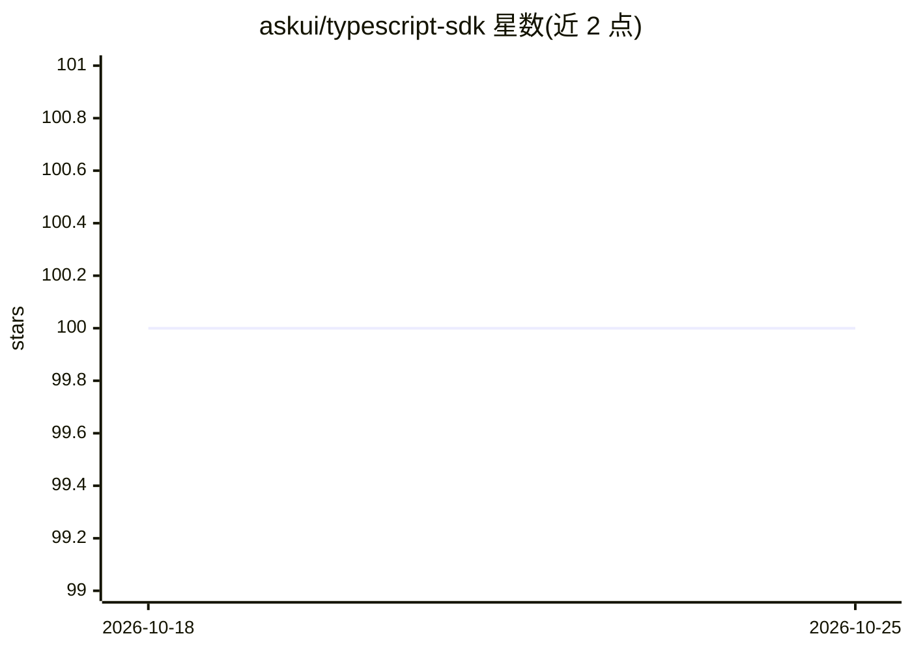

# askui/typescript-sdk

⭐ 100 · TypeScript · MIT · 推送 2026-09-09 · [GitHub](https://github.com/askui/typescript-sdk) · [官网](https://docs.askui.com/) · 组织维护

**基于屏幕内容识别的端到端 UI 自动化 SDK（TypeScript）**

AskUI 的 TypeScript SDK（ADK）仓库，面向端到端自动化与 UI 测试：自动化不依赖被测系统的技术栈或平台，而是依据屏幕上实际显示的内容进行操作。仓库以 monorepo 形式组织，packages 目录下存放不同语言的 ADK。README 主要面向仓库维护者：说明 npm 安装依赖、构建 TypeScript ADK、使用 release-it 的手动发布流程（Node.js 20、npm 发布权限、GITHUB_TOKEN）、Windows 下经 WSL 发布，以及 Conventional Commits、husky githooks 等贡献规范。

## 筛选速览

| 维度 | 判定 | 备注 |
|---|---|---|
| AI 角色 | `ai-enhanced` | 去掉 AI 部分产品仍成立 |
| 许可风险 | `permissive` | MIT |
| 部署形态 | `desktop` | 安装包/桌面程序 |
| 模型依赖 | — | README 未给出锁定关系 |
| 硬件要求 | — | 无带数字的原话,不猜 |
| 安装摩擦 | `low` | 无编译、无系统依赖或容器化 |
| 成熟度 | — | 结构信号不足 |

## 能力要点

- 依据屏幕显示内容而非技术栈/平台执行端到端自动化
- monorepo 结构，packages 下存放不同语言的 ADK
- 发布采用 release-it + Conventional Commits 手动流程

## 适用场景

- 跨平台 UI 端到端测试自动化开发
- 为本项目贡献代码或执行版本发布

## 场景标签

`GUI 自动化` · 领域:效率与自动化

## 证据(README 行号)

> L4: *Reliable, automated end-to-end-automation that only depends on what is shown on your screen instead of the technolo
> L10: This repo contains the AskUI SDK (ADK) written in TypeScript. Releases are done from the root repository. This may 

## 星数曲线

2026-10-18 100 → 2026-10-25 100（+0）

---
*卡片 v1 · prompt 1.4 · 生成 2026-10-23 · 置信度 mid · 依据 README sha `556d59cb790e` · [字段定义](../../DATASET.md)*
