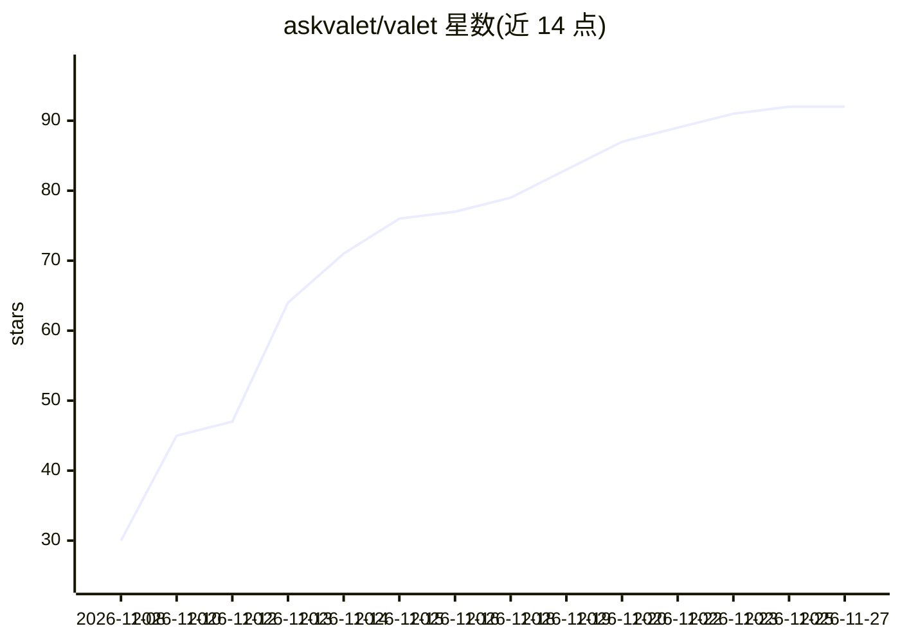

# askvalet/valet

⭐ 92 · TypeScript · MIT · 推送 2026-11-24 · [GitHub](https://github.com/askvalet/valet) · [官网](https://askvalet.dev) · 组织维护

**自托管的家庭服务器 AI 门户主页：聚合 185 个集成并可对话操作**

面向 homelab 用户自托管的开源首页/仪表盘，覆盖 185 个集成（媒体、下载、智能家居等），页面实时更新，支持壁挂展示模式与 3D 户型图控制。AI 助手可连接本地或托管模型（可按会话切换），回答关于服务的问题并代为执行操作（如暂停 Pi-hole、修改自身配置），改动需用户批准；关闭 AI 后产品仍可正常使用。通过 Docker 一键部署，单 Node 进程运行，单一 YAML 配置文件控制全部行为，默认只读直至开启登录。

## 筛选速览

| 维度 | 判定 | 备注 |
|---|---|---|
| AI 角色 | `ai-enhanced` | 去掉 AI 部分产品仍成立 |
| 许可风险 | `permissive` | MIT |
| 部署形态 | `self-host` | docker 或自建部署 |
| 模型依赖 | — | README 未给出锁定关系 |
| 硬件要求 | — | 无带数字的原话,不猜 |
| 安装摩擦 | `low` | 无编译、无系统依赖或容器化 |
| 成熟度 | — | 结构信号不足 |

## 能力要点

- 185 个集成，单 YAML 配置，单一 Node 进程约 45 MB 内存
- AI 助手支持本地或托管模型、按会话切换，操作需用户批准
- 壁挂展示模式（/wall）与实时更新的页面卡片
- API 密钥仅存于服务端，无账号、无遥测

## 适用场景

- 把家庭服务器各类服务集中到一个可实时查看并可操作的首页
- 用对话让助手执行跨服务操作并等待我批准
- 在平板或闲置显示器上展示壁挂式状态页

## 场景标签

`AI 助手` · 领域:对话与助手

## 证据(README 行号)

> L7: A self-hosted, open-source, AI-native homepage.
> L35: Ask Valet anything about your homelab. Use a local model or a hosted one, or several and switch per chat. Valet kno
> L37: works just fine with the AI switched off. You can talk to it, too, with a speech server

## 星数曲线

2026-11-08 30 → 2026-11-27 92（+62）

---
*卡片 v1 · prompt 1.4 · 生成 2026-11-18 · 置信度 high · 依据 README sha `33b0356f5539` · [字段定义](../../DATASET.md)*
