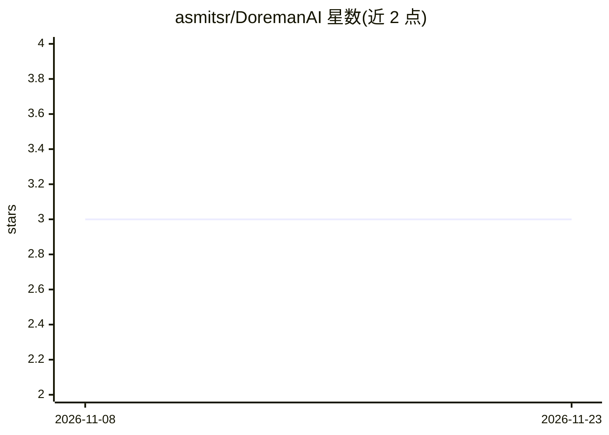

# asmitsr/DoremanAI

⭐ 3 · Kotlin · 推送 2026-11-11 · [GitHub](https://github.com/asmitsr/DoremanAI) · 个人维护

**Android 语音控制的个人助手，支持孟加拉语/英语**

用 Kotlin 与 Jetpack Compose 构建的 Android 语音助手：说出命令即可打开应用、呼叫联系人、通过 Play Store 安装应用、自动发送 WhatsApp 消息、YouTube 播放与设备控制。调用 Gemini 官方 API 或自定义 OpenAI/Anthropic 兼容网关，API 密钥存于 Android Keystore，无自有服务器；常见命令（呼叫、打开应用、音量等）本地直接执行，其余走 AI 规划。提供签名 APK 下载与源码构建路径（Java 17/Gradle 8.5，minSdk 26）。

## 筛选速览

| 维度 | 判定 | 备注 |
|---|---|---|
| AI 角色 | `ai-native` | 本体是模型或模型工具 |
| 许可风险 | `none` | — |
| 部署形态 | `None` |  |
| 模型依赖 | — | README 未给出锁定关系 |
| 硬件要求 | — | 无带数字的原话,不猜 |
| 安装摩擦 | `medium` | 含编译或系统依赖之一 |
| 成熟度 | — | 结构信号不足 |

## 能力要点

- 自定义网关支持 OpenAI 与 Anthropic 两种格式的第三方 Base URL
- 静音唤醒词 "Doreman"，孟加拉语与英语语音命令、TTS 与 AI 回复
- 无障碍服务实现自动点击：Play Store 安装、WhatsApp 自动发送
- 本地快速通道命令不等待 AI 响应

## 适用场景

- 用孟加拉语或英语语音控制手机打开应用、打电话、发消息
- 通过语音自动完成 Play Store 应用安装
- 接入自己的 OpenAI 兼容网关作为 AI 后端

## 场景标签

`AI 助手` `语音 Agent` · 领域:对话与助手

## 证据(README 行号)

> L8: **A Siri-style voice-controlled personal assistant for Android.**
> L10: Speak a command — in Bengali or English — and your phone does the work: it opens apps, calls contacts, installs gam
> L73: |**Google Gemini Official API**|Active|Direct Gemini mode, with fallback models.|

## 星数曲线

2026-11-08 3 → 2026-11-23 3（+0）

---
*卡片 v1 · prompt 1.4 · 生成 2026-11-22 · 置信度 high · 依据 README sha `c41d8b12ff4d` · [字段定义](../../DATASET.md)*
