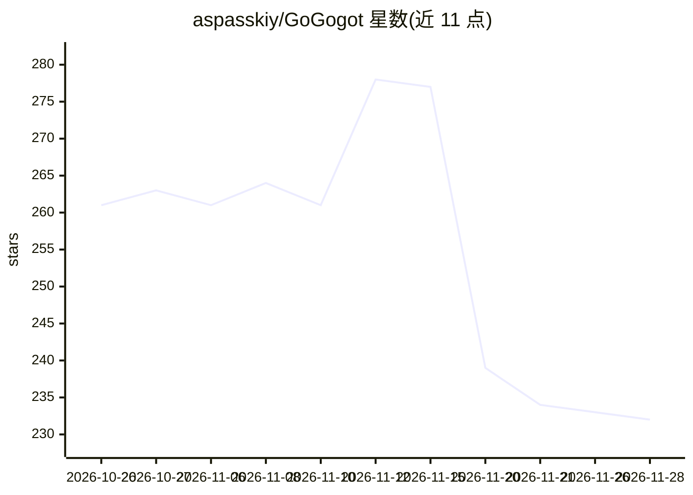

# aspasskiy/GoGogot

⭐ 232 · Go · MIT · 推送 2026-10-28 · [GitHub](https://github.com/aspasskiy/GoGogot) · [官网](https://go-go-got.com/) · 个人维护

**自托管轻量级 AI agent，服务器上执行任务自动化**

GoGogot 是用约 11,500 行 Go 编写的自托管 AI agent，运行于用户自己的服务器：执行 shell 命令、编辑文件、浏览网页、管理持久记忆、调度定时任务。单二进制约 15 MB、内存占用约 10 MB，通过 docker run 部署。接口为插件体系：终端内置，Telegram 以 Python 桥接插件随附，其他通道可用任意语言脚本接入，agent 也可自行编写并连接通道。模型通过环境变量选择 Anthropic/OpenAI/OpenRouter 接入；消息归属校验在核心层完成。需配置 provider、model 与对应 API key 三个环境变量方可启动。

## 筛选速览

| 维度 | 判定 | 备注 |
|---|---|---|
| AI 角色 | `ai-native` | 本体是模型或模型工具 |
| 许可风险 | `permissive` | MIT |
| 部署形态 | `self-host` | docker 或自建部署 |
| 模型依赖 | locked-api |  |
| 硬件要求 | — | 无带数字的原话,不猜 |
| 安装摩擦 | `low` | 无编译、无系统依赖或容器化 |
| 成熟度 | — | 结构信号不足 |

## 能力要点

- 单二进制约 15 MB、内存约 10 MB，一条 docker run 部署，密钥留在用户服务器
- 通道插件机制：任意语言脚本经 stdin/stdout JSON lines 协议接入，agent 可自行编写通道
- 37 个内置工具：文件读写、正则搜索、Brave 搜索、持久记忆、cron 自调度、上下文压缩
- 多模型接入：Anthropic、OpenAI、OpenRouter，模型目录以 JSON 编辑维护

## 适用场景

- 每天定时抓取 AI 新闻并汇总推送给自己
- 下载销售数据、计算汇总并生成 PDF 报告
- 每小时检查服务器磁盘与内存并在超阈值时告警
- 抓取网页提取邮箱和电话存为 CSV

## 场景标签

`AI 助手` `工作流自动化` · 领域:效率与自动化

## 证据(README 行号)

> L11: A **lightweight, extensible, and secure** open-source AI agent that lives on your server. It runs shell commands, e
> L222: The entire agent is a `for` loop. Call the LLM, execute tool calls, feed results back, repeat:

## 星数曲线

2026-10-26 261 → 2026-11-28 232（-29）

---
*卡片 v1 · prompt 1.4 · 生成 2026-11-25 · 置信度 high · 依据 README sha `439376c5e21e` · [字段定义](../../DATASET.md)*
