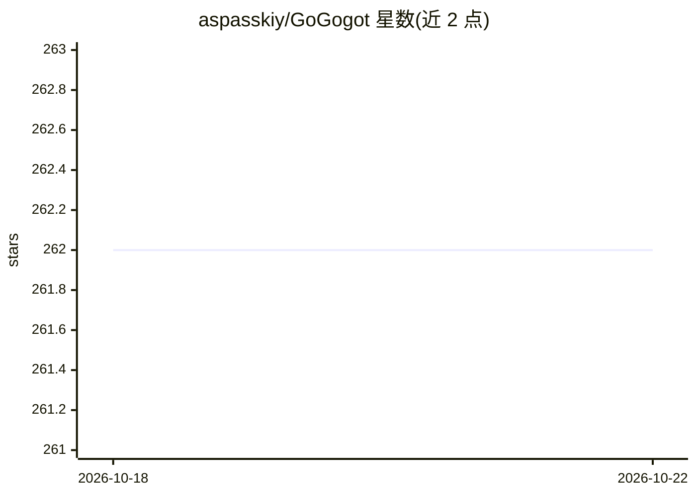

# aspasskiy/GoGogot

⭐ 262 · Go · MIT · 推送 2026-08-26 · [GitHub](https://github.com/aspasskiy/GoGogot) · [官网](https://go-go-got.com/) · 个人维护

**Go 编写的自托管 AI agent，经 Telegram 对话执行任务**

约 9,000 行 Go 核心代码的轻量自托管 AI agent，以单一二进制（约 15 MB、约 10 MB RAM）运行在用户服务器上，通过 Telegram 与所有者交互。内置 34 个工具：bash、文件读写编辑、网页抓取、Brave 搜索、持久化记忆（soul.md/user.md/markdown 笔记）、语义回溯、cron 自调度、上下文压缩与任务规划。模型后端支持 Anthropic、OpenAI 或任意 OpenRouter 模型，通过 Adapter/Channel/Tool 接口扩展。自称 OpenClaw（Claude Code）的开源替代。需要 Telegram Bot Token 且 API key 与模型配置三者齐备才可启动。

## 筛选速览

| 维度 | 判定 | 备注 |
|---|---|---|
| AI 角色 | `ai-native` | 本体是模型或模型工具 |
| 许可风险 | `permissive` | MIT |
| 部署形态 | `self-host` | docker 或自建部署 |
| 模型依赖 | locked-api |  |
| 硬件要求 | — | 无带数字的原话,不猜 |
| 安装摩擦 | `low` | 无编译、无系统依赖或容器化 |
| 成熟度 | — | 结构信号不足 |

## 能力要点

- 单一二进制约 15 MB / 10 MB RAM，docker run 一条命令部署，linux/amd64 与 arm64 镜像
- 34 个内置工具：bash、文件编辑、网页浏览、Brave 搜索、持久化记忆、cron 调度
- 支持 Anthropic、OpenAI、任意 OpenRouter 模型，含短别名与 JSON 目录自定义模型
- Adapter/Channel/Tool Go 接口可扩展新后端、新传输（如 Discord/Slack）与自定义工具

## 适用场景

- 让 agent 定时抓取新闻并发送每日摘要到 Telegram
- 把截图合并为 PDF、从网页提取数据生成报表等文件处理
- 按小时监控服务器磁盘与内存并超阈值告警
- 每周自动拉取 git commits 生成变更日志

## 场景标签

 · 领域:AI agent/自动化

## 证据(README 行号)

> L11: A **lightweight, extensible, and secure** open-source AI agent that lives on your server. It runs shell commands, e
> L117: The entire agent is a `for` loop. Call the LLM, execute tool calls, feed results back, repeat:
> L126: Everything else — memory, scheduling, compaction, identity — is just tools the LLM can call inside this loop.

## 星数曲线

2026-10-18 262 → 2026-10-22 262（+0）

---
*卡片 v1 · prompt 1.4 · 生成 2026-10-22 · 置信度 high · 依据 README sha `13ad0f19fda7` · [字段定义](../../DATASET.md)*
