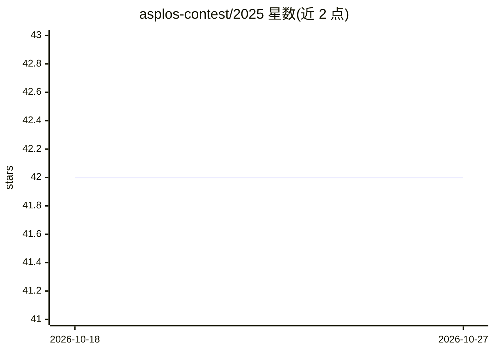

# asplos-contest/2025

⭐ 42 · Apache-2.0 · 推送 2026-06-04 · [GitHub](https://github.com/asplos-contest/2025) · [官网](http://asplos-contest.org) · 组织维护

**ASPLOS/EuroSys 2025 竞赛赛道官方信息页（两项系统竞赛）**

由 ASPLOS 2025 与 EuroSys 2025 组织方发布的竞赛赛道公告仓库：介绍连接学术界与工业界、推动实用可复现方案、奖励人才三个目标。设两项并行竞赛：Google 赞助的分布式深度学习算子内并行竞赛，以及 AWS 赞助的 Llama 3.2 1B 推理 NKI 内核实现优化竞赛，截止 2025 年 3 月 1 日，并提供联系邮箱与特别议程链接。仓库为公告性质，不含软件安装或运行内容。

## 筛选速览

| 维度 | 判定 | 备注 |
|---|---|---|
| AI 角色 | `ai-knowledge` | 知识聚合/清单类 |
| 许可风险 | `permissive` | Apache-2.0 |
| 部署形态 | `None` |  |
| 模型依赖 | — | README 未给出锁定关系 |
| 硬件要求 | — | 无带数字的原话,不猜 |
| 安装摩擦 | `low` | 无编译、无系统依赖或容器化 |
| 成熟度 | — | 结构信号不足 |

## 能力要点

- 两项并行竞赛：分布式深度学习算子内并行与 NKI 实现 Llama 3.2 1B 推理优化
- 面向学生与教师，连接学术界与工业界
- 分别由 Google 与 AWS 赞助，截止 2025-03-01

## 适用场景

- 了解 ASPLOS/EuroSys 2025 竞赛的主题与时间安排
- 寻找计算机系统方向的研究竞赛参与机会
- 通过邮箱向组织方咨询竞赛问题

## 场景标签

 · 领域:计算机系统/学术竞赛

## 证据(README 行号)

> L1: The ASPLOS 2025 and EuroSys 2025 organizers are pleased to announce **The ASPLOS 2025 / EuroSys 2025 Contest Track**
> L11:  * **The ASPLOS 2025 / EuroSys 2025 Contest on Intra-Operator Parallelism for Distributed Deep Learning** sponsored
> L12:  * **The ASPLOS 2025 / EuroSys 2025 Contest on an Optimized Neuron Kernel Interface (NKI) Implementation of Llama 3

## 星数曲线

2026-10-18 42 → 2026-10-27 42（+0）

---
*卡片 v1 · prompt 1.4 · 生成 2026-10-25 · 置信度 high · 依据 README sha `23e7e8c83b22` · [字段定义](../../DATASET.md)*
