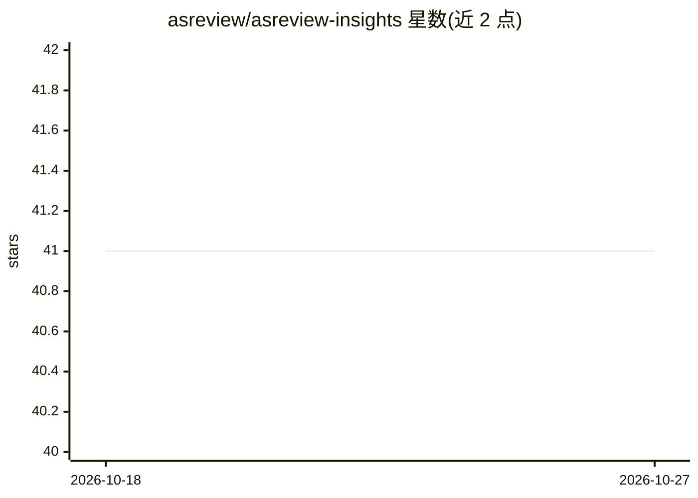

# asreview/asreview-insights

⭐ 41 · Python · Apache-2.0 · 推送 2026-04-13 · [GitHub](https://github.com/asreview/asreview-insights) · [官网](https://www.asreview.ai) · 组织维护

**ASReview LAB 扩展：对主动学习筛选模拟做指标计算与可视化**

乌得勒支大学 ASReview 项目的官方扩展，面向使用 ASReview LAB 进行系统性综述筛选模拟的研究者：从 .asreview 项目文件中读取模拟结果，计算 Recall、WSS/nWSS、ERF、TD/ATD、Normalized Loss 等性能指标，并通过 `asreview plot` 与 `asreview metrics` 两个新增子命令输出 recall/wss/erf 曲线图与统计值。版本兼容性上 1.0-1.5 需 asreview v1，1.6 及以后需 asreview v2。以 PyPI 包安装，依赖 ASReview LAB 运行环境。

## 筛选速览

| 维度 | 判定 | 备注 |
|---|---|---|
| AI 角色 | `ai-ecosystem` | LLM/agent 周边工具 |
| 许可风险 | `permissive` | Apache-2.0 |
| 部署形态 | `library` | 以包/库形式分发 |
| 模型依赖 | — | README 未给出锁定关系 |
| 硬件要求 | — | 无带数字的原话,不猜 |
| 安装摩擦 | `low` | 无编译、无系统依赖或容器化 |
| 成熟度 | — | 结构信号不足 |

## 能力要点

- 计算 Recall、WSS/nWSS、ERF、TD/ATD、Normalized Loss 等主动学习性能指标
- 为 ASReview LAB 扩展 plot 与 metrics 两个命令行子命令
- 从 .asreview 项目文件生成 recall/wss/erf 曲线图
- 明确版本兼容：1.0-1.5 需 asreview v1，1.6+ 需 asreview v2

## 适用场景

- 我在跑完 ASReview 模拟后想量化模型筛选性能
- 我要对比多个主动学习模型在综述筛选任务上的表现
- 我想绘制 recall/WSS/ERF 曲线用于论文或报告

## 场景标签

`模型评测` · 领域:评测与运维

## 证据(README 行号)

> L5: This official extension to [ASReview
> L37: The ASReview Insights extension is useful for measuring the performance of
> L43: multiple models can be measured by different metrics and the ASReview Insights

## 星数曲线

2026-10-18 41 → 2026-10-27 41（+0）

---
*卡片 v1 · prompt 1.4 · 生成 2026-10-25 · 置信度 high · 依据 README sha `85cb665d004f` · [字段定义](../../DATASET.md)*
