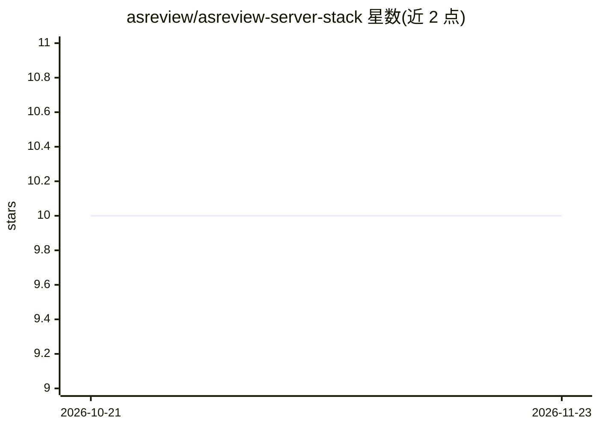

# asreview/asreview-server-stack

⭐ 10 · Dockerfile · MIT · 推送 2026-06-17 · [GitHub](https://github.com/asreview/asreview-server-stack) · [官网](https://asreview.ai) · 组织维护

**用 Docker Compose 部署带多用户认证的 ASReview LAB 服务器**

提供一组 Docker Compose 配置，将 ASReview LAB 应用部署为带认证的多用户服务器：用户可通过多种方式注册登录并创建私有项目。技术栈由 NGINX、PostgreSQL 与 ASReview 三个容器组成，均由 Docker 自动安装运行。文档覆盖服务器准备（Ubuntu 示例）、防火墙配置、HTTP 快速部署、可选的 SMTP 邮箱验证，以及迁移到 HTTPS（Certbot/Let's Encrypt 证书）的步骤；README 明确提示公网部署需自行考虑安全影响。

## 筛选速览

| 维度 | 判定 | 备注 |
|---|---|---|
| AI 角色 | `ai-ecosystem` | LLM/agent 周边工具 |
| 许可风险 | `permissive` | MIT |
| 部署形态 | `self-host` | docker 或自建部署 |
| 模型依赖 | — | README 未给出锁定关系 |
| 硬件要求 | — | 无带数字的原话,不猜 |
| 安装摩擦 | `low` | 无编译、无系统依赖或容器化 |
| 成熟度 | — | 结构信号不足 |

## 能力要点

- 三个容器（NGINX/PostgreSQL/ASReview）由 Docker Compose 编排启动
- 多用户注册登录，支持私有项目隔离
- 可选邮箱验证与密码重置（外部 SMTP 服务）
- 含 HTTPS 迁移流程：域名、Certbot 证书、端口与配置调整

## 适用场景

- 为团队部署多用户的 ASReview 系统综述平台
- 在内网可信环境中快速起一套 HTTP 测试部署
- 将已有 HTTP 部署升级为带 TLS 证书的 HTTPS 服务

## 场景标签

`科研工具` · 领域:学习与行业

## 证据(README 行号)

> L8: This repository, ASReview Server Stack, contains a recipe for building an
> L10: Docker Compose. It allows multiple users to access the application and create

## 星数曲线

2026-10-21 10 → 2026-11-23 10（+0）

---
*卡片 v1 · prompt 1.4 · 生成 2026-11-20 · 置信度 high · 依据 README sha `5c49eb380bab` · [字段定义](../../DATASET.md)*
