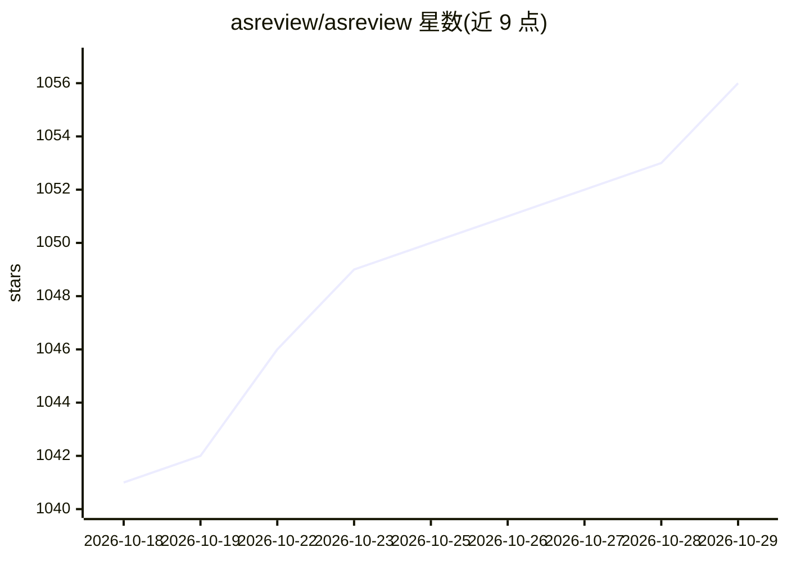

# asreview/asreview

⭐ 1,056 · Python · Apache-2.0 · 推送 2026-10-26 · [GitHub](https://github.com/asreview/asreview) · [官网](https://asreview.ai) · 组织维护

**系统综述文献筛选的主动学习工具：AI 排序相关记录**

面向系统综述、元分析及大规模文本筛选场景的开源机器学习工具 ASReview LAB：以人作为标注者，AI 模型从标注决策中学习并交互式优先排序待筛选记录，从而减少人工阅读量。支持导入 CSV/RIS/XLSX 等格式数据，提供预配置 ELAS 模型与自定义组件、在已标注数据集上评估模型表现的仿真工具包、自动保存并可修改的标签管理、重复记录自动隐藏与可编辑标签。方法论发表于 Nature Machine Intelligence。需 Python 3.10+，pip 安装，文档另含 Docker 安装指引。

## 筛选速览

| 维度 | 判定 | 备注 |
|---|---|---|
| AI 角色 | `ai-native` | 本体是模型或模型工具 |
| 许可风险 | `permissive` | Apache-2.0 |
| 部署形态 | `library` | 以包/库形式分发 |
| 模型依赖 | — | README 未给出锁定关系 |
| 硬件要求 | — | 无带数字的原话,不猜 |
| 安装摩擦 | `low` | 无编译、无系统依赖或容器化 |
| 成熟度 | — | 结构信号不足 |

## 能力要点

- 主动学习：AI 模型从 Relevant/Not Relevant 标注中学习并优先排序记录
- 仿真工具包：在完全标注数据集上评估模型性能
- 重复标题/文本记录在筛选时自动隐藏，导出时可选恢复
- 方法论发表于 Nature Machine Intelligence，不收集使用或用户数据

## 适用场景

- 系统综述/元分析中加速大规模文献筛选
- 在已标注数据集上仿真评估主动学习模型表现
- 对大型文本数据集做系统化的相关性标注与导出

## 场景标签

`科研工具` · 领域:学习与行业

## 证据(README 行号)

> L7: **ASReview LAB** is an open-source machine learning tool for efficient,
> L14: - **Active Learning**: Interactively prioritize records using AI models that
> L64: 4. **Start Screening**: Label records as Relevant or Not Relevant; the AI model

## 星数曲线

2026-10-18 1,041 → 2026-10-29 1,056（+15）

---
*卡片 v1 · prompt 1.4 · 生成 2026-10-21 · 置信度 high · 依据 README sha `6c684dbea362` · [字段定义](../../DATASET.md)*
