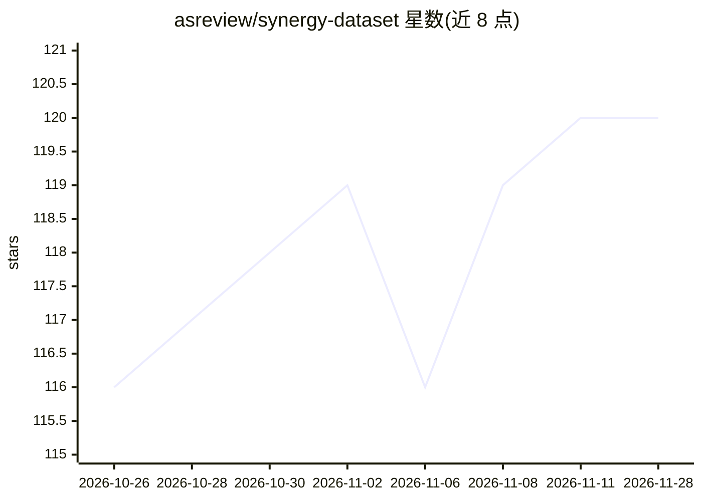

# asreview/synergy-dataset

⭐ 120 · Python · CC0-1.0 · 推送 2026-11-12 · [GitHub](https://github.com/asreview/synergy-dataset) · 组织维护

**系统综述文献筛选的开放机器学习数据集（114 篇综述/168,948 条记录）**

SYNERGY+ 是 SYNERGY 数据集的新版本，面向系统综述中的文献筛选任务，收录 114 篇综述、168,948 条全部开放获取的记录，每条记录为 OpenAlex Work 对象，含标题、摘要、作者、引用关系、主题等变量及 expert 筛选标签。通过 synergy-dataset Python 包分发，支持下载构建、数据集列表查看与 80/20 分层 train/test 划分访问，附 Zenodo 预印本与 CC0 1.0 许可，供 NLP、机器学习、网络分析等方向的研究者使用。

## 筛选速览

| 维度 | 判定 | 备注 |
|---|---|---|
| AI 角色 | `ai-knowledge` | 知识聚合/清单类 |
| 许可风险 | `viral` | CC0-1.0 |
| 部署形态 | `library` | 以包/库形式分发 |
| 模型依赖 | — | README 未给出锁定关系 |
| 硬件要求 | — | 无带数字的原话,不猜 |
| 安装摩擦 | `low` | 无编译、无系统依赖或容器化 |
| 成熟度 | — | 结构信号不足 |

## 能力要点

- 114 篇系统综述、168,948 条全开放获取记录
- 每条记录为 OpenAlex Work 对象，含筛选标签与丰富元数据
- 提供分层 80/20 train/test 划分，可经 Python API 访问
- CC0 1.0 许可并附 Zenodo 预印本

## 适用场景

- 为稀疏标签场景训练和评估文献筛选算法
- 开展系统综述自动化筛选方法的基准测试
- 基于引文网络与作者元数据做学术网络分析

## 场景标签

`科研工具` · 领域:学习与行业

## 证据(README 行号)

> L7: Just like SYNERGY, it is a free and open dataset on study selection in systematic reviews. It is a unique dataset fo
> L20: The easiest way to get the SYNERGY+ dataset is via the `synergy-dataset` Python package. Install the package with:

## 星数曲线

2026-10-26 116 → 2026-11-28 120（+4）

---
*卡片 v1 · prompt 1.4 · 生成 2026-11-28 · 置信度 high · 依据 README sha `e3a23f4a0a2a` · [字段定义](../../DATASET.md)*
