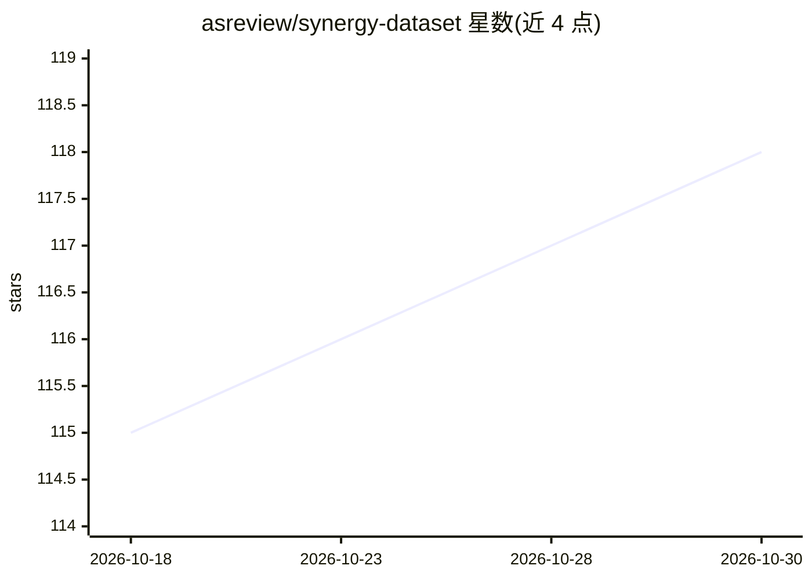

# asreview/synergy-dataset

⭐ 118 · Python · CC0-1.0 · 推送 2026-08-27 · [GitHub](https://github.com/asreview/synergy-dataset) · 组织维护

**给研究者：系统综述研究筛选标注数据集（169,288 条记录）**

SYNERGY 是关于系统综述中研究筛选的开放数据集：收录 26 篇系统综述的 169,288 条学术文献记录，其中 2,834 条（1.67%）被标注为纳入，适用于稀疏标签下信息检索算法开发与 NLP、机器学习、网络分析研究。每条记录为 OpenAlex Work 对象，含标题、摘要、作者、参考文献、主题、引用数等变量，共 82,668,134 个可训练数据点。通过 synergy-dataset Python 包下载与构建，提供 list/show/attribution 命令。数据以 CC0 1.0 发布，Benchmark 部分为进行中。

## 筛选速览

| 维度 | 判定 | 备注 |
|---|---|---|
| AI 角色 | `ai-knowledge` | 知识聚合/清单类 |
| 许可风险 | `viral` | CC0-1.0 |
| 部署形态 | `library` | 以包/库形式分发 |
| 模型依赖 | — | README 未给出锁定关系 |
| 硬件要求 | — | 无带数字的原话,不猜 |
| 安装摩擦 | `low` | 无编译、无系统依赖或容器化 |
| 成熟度 | — | 结构信号不足 |

## 能力要点

- 26 篇系统综述共 169,288 条记录，2,834 条纳入标注（1.67% 稀疏标签）
- 每条记录为 OpenAlex Work 对象，含标题、摘要、作者、参考文献、主题等变量
- 共 82,668,134 个可训练数据点
- 提供 Python 包（pip 安装）含下载构建与数据查看命令

## 适用场景

- 我为系统综述筛选任务开发主动学习/信息检索算法
- 我在稀疏标签场景下做 NLP 或机器学习研究
- 我需要带纳入/排除标注的文献数据做网络分析

## 场景标签

`科研工具` · 领域:学习与行业

## 证据(README 行号)

> L5: SYNERGY is a free and open dataset on study selection in systematic reviews, comprising 169,288 academic works from 
> L100: > De Bruin, Jonathan; Ma, Yongchao; Ferdinands, Gerbrich; Teijema, Jelle; Van de Schoot, Rens, 2023, "SYNERGY - Op

## 星数曲线

2026-10-18 115 → 2026-10-30 118（+3）

---
*卡片 v1 · prompt 1.4 · 生成 2026-10-23 · 置信度 high · 依据 README sha `b5146387fe1e` · [字段定义](../../DATASET.md)*
