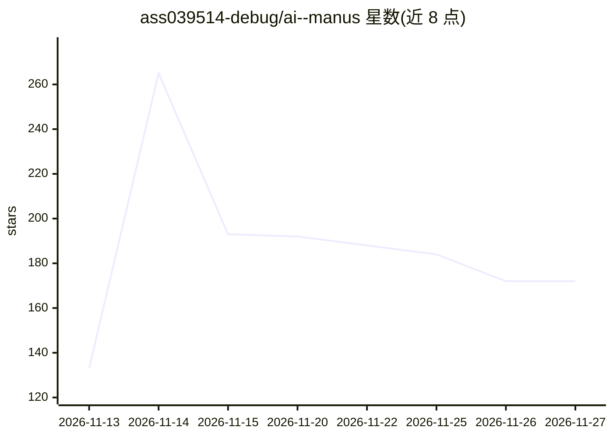

# ass039514-debug/ai--manus

⭐ 172 · Apache-2.0 · 推送 2026-11-15 · [GitHub](https://github.com/ass039514-debug/ai--manus) · 个人维护

**自主执行代码与浏览器操作的通用 AI Agent 助手**

面向家庭、学习与轻量办公场景的自主 AI Agent：用户以自然语言下达指令，Agent 自行编写并执行脚本、控制浏览器（导航、填表、抓取信息），完成多步骤任务，可在后台持续运行并跨会话复用工作流。README 声明其定位为小型任务的专注助手，非企业级平台。文档给出硬件兼容表（最低 4GB 内存、双核 CPU）与上手步骤，但未提供具体安装命令、源码结构或 API 接入说明，README 以功能描述为主。

## 筛选速览

| 维度 | 判定 | 备注 |
|---|---|---|
| AI 角色 | `ai-native` | 本体是模型或模型工具 |
| 许可风险 | `permissive` | Apache-2.0 |
| 部署形态 | `None` |  |
| 模型依赖 | — | README 未给出锁定关系 |
| 硬件要求 | — | 无带数字的原话,不猜 |
| 安装摩擦 | `low` | 无编译、无系统依赖或容器化 |
| 成熟度 | — | 结构信号不足 |

## 能力要点

- 自主编写并执行代码完成多步任务
- 浏览器控制：导航网页、填写表单、采集信息
- 代码执行与浏览器操作可在同一工作流中衔接
- 后台个人助手形态，跨会话保持一致行为

## 适用场景

- 让学生整理研究笔记、运行小脚本
- 让 Agent 代为浏览多个页面收集信息并汇总
- 自动完成重复性的表单填写与文件整理等日常杂务

## 场景标签

`AI 助手` `编码 Agent` `浏览器自动化` · 领域:效率与自动化

## 证据(README 行号)

> L10: - **Autonomous Code Execution:** Manus AI agent runs code on its own to complete tasks, so you can focus on decisio
> L18: Manus is an autonomous AI agent designed to run code and control a browser on your behalf. Instead of acting like a

## 星数曲线

2026-11-13 133 → 2026-11-27 172（+39）

---
*卡片 v1 · prompt 1.4 · 生成 2026-11-17 · 置信度 mid · 依据 README sha `fbfd5e977bf4` · [字段定义](../../DATASET.md)*
