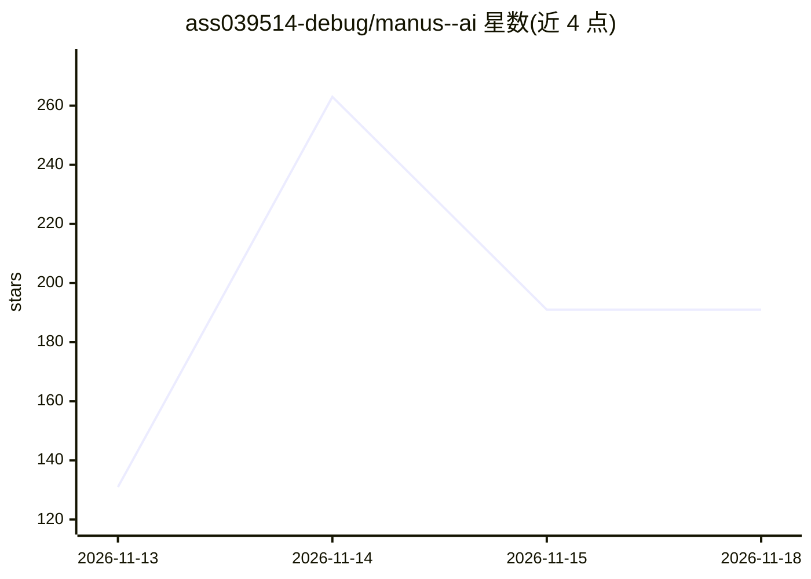

# ass039514-debug/manus--ai

⭐ 191 · Apache-2.0 · 推送 2026-11-15 · [GitHub](https://github.com/ass039514-debug/manus--ai) · 个人维护

**自主 AI Agent：代用户执行代码与控制浏览器完成任务**

面向家庭、学习与轻量办公场景的自主 AI 代理：用户以自然语言下达指令，代理自行编写并执行脚本、打开网页、填写表单、完成多步任务，无需编程基础。代码执行与浏览器控制可在同一流程中衔接，跨会话保持工作模式。README 给出硬件兼容表（最低双核 CPU、4 GB 内存）与配置、测试、维护等使用步骤，但未提供具体的安装命令、下载渠道细节或模型接入方式。

## 筛选速览

| 维度 | 判定 | 备注 |
|---|---|---|
| AI 角色 | `ai-native` | 本体是模型或模型工具 |
| 许可风险 | `permissive` | Apache-2.0 |
| 部署形态 | `None` |  |
| 模型依赖 | — | README 未给出锁定关系 |
| 硬件要求 | — | 无带数字的原话,不猜 |
| 安装摩擦 | `low` | 无编译、无系统依赖或容器化 |
| 成熟度 | — | 结构信号不足 |

## 能力要点

- 自主执行代码与控制浏览器，完成多步任务
- 代码与浏览器操作可在同一流程内衔接
- 面向非开发者，无需编程基础
- 跨会话记忆并复用工作模式

## 适用场景

- 让学生整理研究笔记、跑小型脚本
- 远程工作者从多个网页收集数据
- 把重复的表单填写、文件整理等小任务委托给代理

## 场景标签

`浏览器自动化` `编码 Agent` · 领域:效率与自动化

## 证据(README 行号)

> L10: - **Autonomous Code Execution:** Manus AI agent runs code on its own to complete tasks, so you can focus on decisio
> L18: Manus is an autonomous AI agent designed to run code and control a browser on your behalf. Instead of acting like a

## 星数曲线

2026-11-13 131 → 2026-11-18 191（+60）

---
*卡片 v1 · prompt 1.4 · 生成 2026-11-17 · 置信度 mid · 依据 README sha `0f78ee3a5dd2` · [字段定义](../../DATASET.md)*
