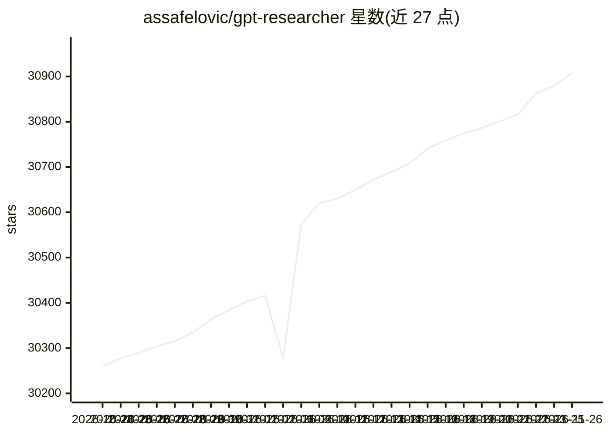

# assafelovic/gpt-researcher

⭐ 30,908 · Python · Apache-2.0 · 推送 2026-11-23 · [GitHub](https://github.com/assafelovic/gpt-researcher) · [官网](https://gptr.dev) · 个人维护

**自主深度研究 Agent：生成带引用的研究报告**

GPT Researcher 是一个自主研究代理，针对给定任务基于网络与本地文档开展深度研究，输出带引用的详细研究报告。核心机制为 planner 与 execution 双代理：规划器生成研究问题，执行代理抓取信息，发布器聚合为报告；支持递归树状深度研究、多代理协作（LangGraph/AG2）、Jev 上下文过滤、MCP 数据源接入与内联图像生成。可经 pip、源码或 Docker 运行，也可安装为 Claude Skill 或 MCP Server 供 AI 应用调用。报告成本按运行追踪记录。

## 筛选速览

| 维度 | 判定 | 备注 |
|---|---|---|
| AI 角色 | `ai-native` | 本体是模型或模型工具 |
| 许可风险 | `permissive` | Apache-2.0 |
| 部署形态 | `self-host` | docker 或自建部署 |
| 模型依赖 | — | README 未给出锁定关系 |
| 硬件要求 | — | 无带数字的原话,不猜 |
| 安装摩擦 | `low` | 无编译、无系统依赖或容器化 |
| 成熟度 | — | 结构信号不足 |

## 动量与使用信号

- 维护:`active` — 距上次 push 7.4 天,年发版 13,252 位贡献者
- 涨星:近 1 天 **+19**(自 20261016 起算)
- 安装:npm 包 `skills` 月下载 23,786,800
- 平台:— · 协议:OPENAI-API / MCP

## 能力要点

- planner/execution/publisher 多代理架构生成带引用报告
- 递归树状深度研究，可配置深度与广度，并发执行
- Jev 上下文过滤，无 API key 时回退到本地 BM25 关键词排序
- 支持 MCP 接入 GitHub、数据库等数据源与本地文档研究（PDF/CSV/Excel/Word 等）

## 适用场景

- 把一个研究问题变成一份带引用的长篇报告
- 基于本地文档库开展研究并导出 PDF/Word
- 让 Claude 等 AI 助手通过 MCP 获得深度研究能力
- 定制领域专属的研究代理

## 场景标签

`科研工具` `多智能体` · 领域:Agent 开发

## 证据(README 行号)

> L20: **GPT Researcher is the first open deep research agent designed for both web and local research on any given task.*
> L22: The agent produces detailed, factual, and unbiased research reports with citations. GPT Researcher provides a full 
> L53: The core idea is to utilize 'planner' and 'execution' agents. The planner generates research questions, while the e

## 星数曲线

2026-10-24 30,261 → 2026-11-26 30,908（+647）

---
*卡片 v1 · prompt 1.4 · 生成 2026-11-25 · 置信度 high · 依据 README sha `94425fc35839` · [字段定义](../../DATASET.md)*
