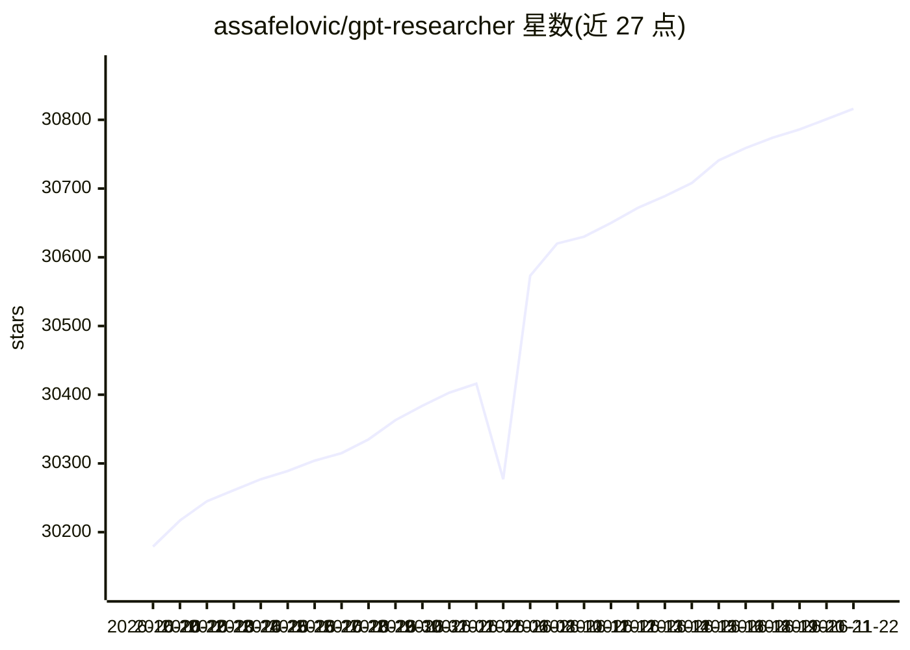

# assafelovic/gpt-researcher

⭐ 30,816 · Python · Apache-2.0 · 推送 2026-11-12 · [GitHub](https://github.com/assafelovic/gpt-researcher) · [官网](https://gptr.dev) · 个人维护

**自主深度研究 agent：生成带引用的研究报告**

开源深度研究 agent，对给定任务在 web 与本地文档上开展研究，产出带引用的详细研究报告。采用 planner/execution 多 agent 架构：规划生成研究问题，执行 agent 爬取并汇总信息，publisher 聚合为报告；支持递归深度研究、并行运行、上下文过滤（默认 Jev，无 key 时回退本地 BM25）、Gemini 内联插图生成、PDF/Word 导出。提供 Python 包、FastAPI 服务与 Docker 部署，可作为 MCP server 供 Claude 等应用调用。

## 筛选速览

| 维度 | 判定 | 备注 |
|---|---|---|
| AI 角色 | `ai-native` | 本体是模型或模型工具 |
| 许可风险 | `permissive` | Apache-2.0 |
| 部署形态 | `self-host` | docker 或自建部署 |
| 模型依赖 | — | README 未给出锁定关系 |
| 硬件要求 | — | 无带数字的原话,不猜 |
| 安装摩擦 | `low` | 无编译、无系统依赖或容器化 |
| 成熟度 | — | 结构信号不足 |

## 动量与使用信号

- 维护:`active` — 距上次 push 7.4 天,年发版 13,252 位贡献者
- 涨星:近 1 天 **+19**(自 20261016 起算)
- 安装:npm 包 `skills` 月下载 23,786,800
- 平台:— · 协议:OPENAI-API / MCP

## 能力要点

- planner/execution 多 agent 架构，报告超过 2,000 词、聚合 20+ 来源
- 支持 web 与本地文档（PDF/CSV/Excel/Word 等）研究
- Jev 上下文过滤，无 API key 时回退本地 BM25
- 可安装为 Claude Skill，并独立提供 MCP server

## 适用场景

- 输入研究问题，自动生成带引用的深度调研报告
- 基于本地文档库开展研究并导出报告
- 给 Claude 等 AI 助手接入深度研究能力

## 场景标签

`多智能体` `科研工具` · 领域:Agent 开发

## 证据(README 行号)

> L20: **GPT Researcher the first open deep research agent designed for both web and local research on any given task.**
> L22: The agent produces detailed, factual, and unbiased research reports with citations. GPT Researcher provides a full 

## 星数曲线

2026-10-20 30,179 → 2026-11-22 30,816（+637）

---
*卡片 v1 · prompt 1.4 · 生成 2026-11-22 · 置信度 high · 依据 README sha `f2af3b310a2f` · [字段定义](../../DATASET.md)*
