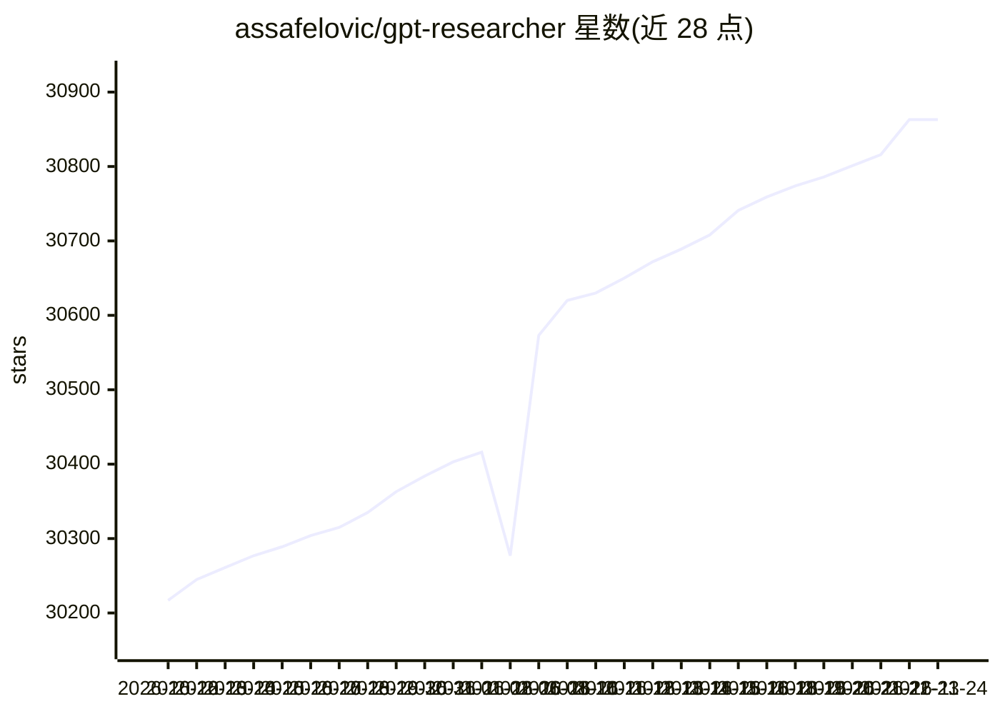

# assafelovic/gpt-researcher

⭐ 30,863 · Python · Apache-2.0 · 推送 2026-11-22 · [GitHub](https://github.com/assafelovic/gpt-researcher) · [官网](https://gptr.dev) · 个人维护 · 中文 README

**自主深度研究 agent：输入问题生成带引用的研究报告**

自主研究代理，对给定任务产出带引用的详细研究报告。采用规划 agent 与执行 agent 架构：规划生成研究问题，执行抓取网页与本地文档信息，发布者聚合为报告；支持递归深度研究、多 agent 协作（LangGraph、AG2）、超过 2000 词报告与 20+ 来源聚合。面向需要自动化研究的个人与组织。默认用 Jev 做上下文过滤，无 API key 时回退到本地 BM25 关键词排序；需配置 LLM API key 才能运行。

## 筛选速览

| 维度 | 判定 | 备注 |
|---|---|---|
| AI 角色 | `ai-native` | 本体是模型或模型工具 |
| 许可风险 | `permissive` | Apache-2.0 |
| 部署形态 | `self-host` | docker 或自建部署 |
| 模型依赖 | — | README 未给出锁定关系 |
| 硬件要求 | — | 无带数字的原话,不猜 |
| 安装摩擦 | `low` | 无编译、无系统依赖或容器化 |
| 成熟度 | `idea` | |

## 动量与使用信号

- 维护:`active` — 距上次 push 7.4 天,年发版 13,252 位贡献者
- 涨星:近 1 天 **+19**(自 20261016 起算)
- 安装:npm 包 `skills` 月下载 23,786,800
- 平台:— · 协议:OPENAI-API / MCP

## 能力要点

- 生成带引用的详细研究报告，支持 PDF/Word 等格式导出
- 支持网页与本地文档（PDF、CSV、Excel、Word 等）作为研究来源
- MCP 客户端接入 GitHub、数据库等数据源，另有独立 MCP 服务器供 Claude 等应用调用
- 上下文过滤默认用 Jev，无 key 时回退本地 BM25，无需嵌入

## 适用场景

- 把一个研究问题变成带引用的长篇调研报告
- 基于本地文档库做研究与汇总
- 将深度研究能力接入 Claude 等 AI 助手
- 构建领域定制的多 agent 研究工作流

## 场景标签

`科研工具` · 领域:学习与行业

## 证据(README 行号)

> L22: The agent produces detailed, factual, and unbiased research reports with citations. GPT Researcher provides a full 
> L53: The core idea is to utilize 'planner' and 'execution' agents. The planner generates research questions, while the e
> L103:     export OPENAI_API_KEY={Your OpenAI API Key here}

## 星数曲线

2026-10-22 30,217 → 2026-11-24 30,863（+646）

---
*卡片 v1 · prompt 1.4 · 生成 2026-11-23 · 置信度 high · 依据 README sha `31448633dec4` · [字段定义](../../DATASET.md)*
