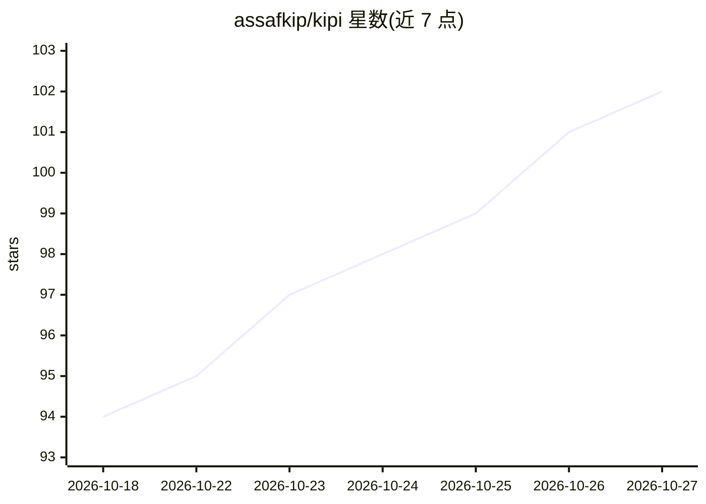

# assafkip/kipi

⭐ 102 · Python · NOASSERTION · 推送 2026-10-22 · [GitHub](https://github.com/assafkip/kipi) · 个人维护

**自托管 OSINT 调查平台：文档转实体图谱并由 agent 自主调查**

面向以调查为职业的分析师（威胁情报、反欺诈/AML、记者等）的自托管开源情报平台：摄入 PDF、截图、表格等文档并抽取为类型化实体图谱，随后自主调查 agent 从种子（域名/钱包/账号）出发拉取 WHOIS、DNS、证书等公开数据并持续扩展图谱，附带中心性、社区发现、寻路等图分析，最终生成带来源与证据分级的书面简报。所有 schema、发现与边均由人工分析师确认或否决。唯一必需的 API key 是 Anthropic；无 key 工具带（whois/DNS/RDAP/crt.sh 等）零 key 可用。本地 SQLite 存储，Elastic License 2.0 源码可用许可，禁止转售或托管服务化。

## 筛选速览

| 维度 | 判定 | 备注 |
|---|---|---|
| AI 角色 | `ai-native` | 本体是模型或模型工具 |
| 许可风险 | `none` | NOASSERTION |
| 部署形态 | `None` |  |
| 模型依赖 | locked-api |  |
| 硬件要求 | — | 无带数字的原话,不猜 |
| 安装摩擦 | `low` | 无编译、无系统依赖或容器化 |
| 成熟度 | — | 结构信号不足 |

## 能力要点

- 文档摄入抽取为类型化实体图谱（含 6 语言 OCR）
- 自主调查 agent：种子→WHOIS/DNS/证书/网页→枢轴扩展→带证据分级的简报
- 图分析：介数中心性、Louvain 社区、寻路、条件格式化与全图谱溯源
- 零 key 工具带：whois/DNS/RDAP/crt.sh/Shodan InternetDB/BTC 钱包等 13 项

## 适用场景

- 把泄露文档和密集报告整理成可调查的实体关系图谱
- 从单个域名或钱包出发追查欺诈网络与基础设施关联
- 输出每条主张都带来源与证据等级的案件简报

## 场景标签

`知识图谱` `网络安全` `文档解析` · 领域:知识与检索

## 证据(README 行号)

> L7: The graph above built itself. One seed domain went in. An agent pulled WHOIS, DNS, certificates, and the live sites,
> L9: kipi is an open-source, self-hosted OSINT investigation platform. It turns documents into an investigation. PDFs, sc
> L47: |`ANTHROPIC_API_KEY`|**Yes**|No entity classification, no schema proposal, no brief|

## 星数曲线

2026-10-18 94 → 2026-10-27 102（+8）

---
*卡片 v1 · prompt 1.4 · 生成 2026-10-23 · 置信度 high · 依据 README sha `a6ed6465a63b` · [字段定义](../../DATASET.md)*
