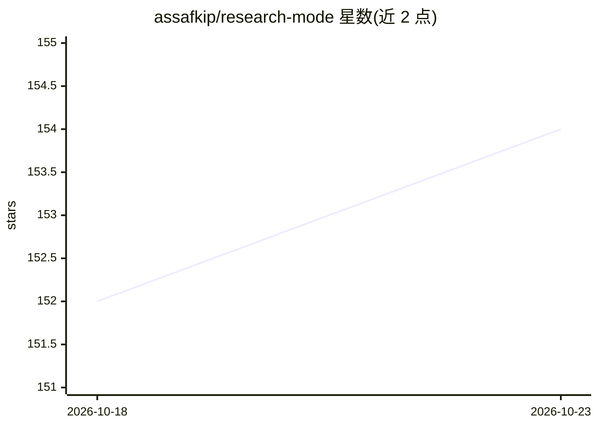

# assafkip/research-mode

⭐ 154 · 推送 2026-04-16 · [GitHub](https://github.com/assafkip/research-mode) · 个人维护

**Claude Code 的防幻觉开关插件：强制引用与来源落地**

以插件/技能形式安装到 Claude Code（CLI、macOS 桌面端、VS Code 扩展）的开关式研究模式：激活后同时施加三条约束——不确定时说"我不知道"、每条声明必须引用文件/URL/论文等来源（无来源则撤回）、回答先逐字引用再分析。来源按本地文件→WebSearch 快照→WebFetch→Scholar Gateway 顺序级联以控制 token 成本，单题限 5 次 WebSearch、3 次 WebFetch。也内置 Kipi Founder OS（kipi-core）中，可用 /q-research 调用。非持续开启，按需切换。

## 筛选速览

| 维度 | 判定 | 备注 |
|---|---|---|
| AI 角色 | `ai-ecosystem` | LLM/agent 周边工具 |
| 许可风险 | `none` | — |
| 部署形态 | `None` |  |
| 模型依赖 | — | README 未给出锁定关系 |
| 硬件要求 | — | 无带数字的原话,不猜 |
| 安装摩擦 | `low` | 无编译、无系统依赖或容器化 |
| 成熟度 | — | 结构信号不足 |

## 能力要点

- 三条约束同时激活：承认未知、全量引用、先引用原文再分析
- 四级来源级联（本地文件→WebSearch→WebFetch→Scholar Gateway）控制 token 成本
- 单题 token 预算：最多 5 次 WebSearch、3 次 WebFetch
- 支持插件市场安装或复制 SKILL.md 作为独立技能两种方式

## 适用场景

- 做重要研究时让 Claude Code 强制引用来源、不编造事实
- 投研/竞品调研等需要可核查出处的 AI 输出场景
- 写作类工作时关闭约束，研究时再开启

## 场景标签

`科研工具` · 领域:学习与行业

## 证据(README 行号)

> L3: Anti-hallucination toggle for Claude Code. Activates citation constraints from Anthropic's documentation that force 
> L42: Three constraints activate simultaneously:
> L48: ## Source cascade (keeps token costs low)

## 星数曲线

2026-10-18 152 → 2026-10-23 154（+2）

---
*卡片 v1 · prompt 1.4 · 生成 2026-10-23 · 置信度 high · 依据 README sha `2b89f6a8dc3c` · [字段定义](../../DATASET.md)*
