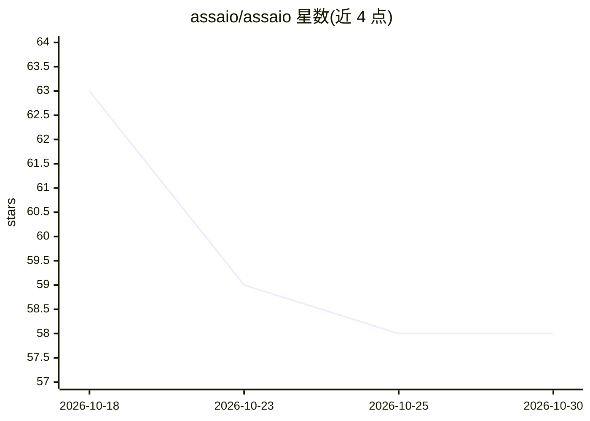

# assaio/assaio

⭐ 58 · Go · Apache-2.0 · 推送 2026-10-16 · [GitHub](https://github.com/assaio/assaio) · [官网](https://assaio.dev) · 组织维护

**离线 CLI：分析 AI 编码工具使用情况与成本估算**

Go 编写的单二进制 CLI（assaio-agent），内嵌 SQLite，读取 Claude Code、Codex CLI、Gemini CLI、GitHub Copilot CLI、Cline 和 Antigravity CLI 的本地日志，产出使用广度统计、基于 LiteLLM 价格快照的 API 等效成本估算，以及会话→提交候选项与有界的 PR/review/CI 观测（经用户自己的 gh）。不采集 prompt、响应或代码内容，默认假名化且拒绝按人排名。面向平台团队、工程效能团队与个人开发者；可选自托管 team mode 为 MVP。

## 筛选速览

| 维度 | 判定 | 备注 |
|---|---|---|
| AI 角色 | `ai-ecosystem` | LLM/agent 周边工具 |
| 许可风险 | `permissive` | Apache-2.0 |
| 部署形态 | `library` | 以包/库形式分发 |
| 模型依赖 | — | README 未给出锁定关系 |
| 硬件要求 | — | 无带数字的原话,不猜 |
| 安装摩擦 | `low` | 无编译、无系统依赖或容器化 |
| 成熟度 | `idea` | |

## 能力要点

- 读取 6 种 AI 编码工具的本地日志，跨工具统一口径估算 API 等效成本
- evidence 命令报告 session→commit 候选关系（matched/ambiguous/unmatched，不做因果归因）
- 离线优先：正常分析路径无网络请求、无遥测，数据存本地 SQLite
- 每个指标附来源覆盖率、样本量、新鲜度与解析器版本，缺失数据不计为零

## 适用场景

- 我在团队内盘点各 AI 编码工具的使用广度与估算成本
- 在本地仓库中查看候选提交周边的 PR/review/CI 证据
- 生成离线自包含 HTML 仪表盘并与下载的账单导出对账

## 场景标签

`LLM 可观测性` · 领域:评测与运维

## 证据(README 行号)

> L5: assaio is an open-source, offline-first Go CLI (`assaio-agent`) with embedded SQLite for Claude
> L7: teams can inspect observed usage breadth, API-equivalent cost estimates and bounded local PR,
> L25: - What are the API-equivalent cost estimates for Claude Code, Codex, Gemini CLI, Copilot CLI and Cline?

## 星数曲线

2026-10-18 63 → 2026-10-30 58（-5）

---
*卡片 v1 · prompt 1.4 · 生成 2026-10-24 · 置信度 high · 依据 README sha `923ddef50b3f` · [字段定义](../../DATASET.md)*
