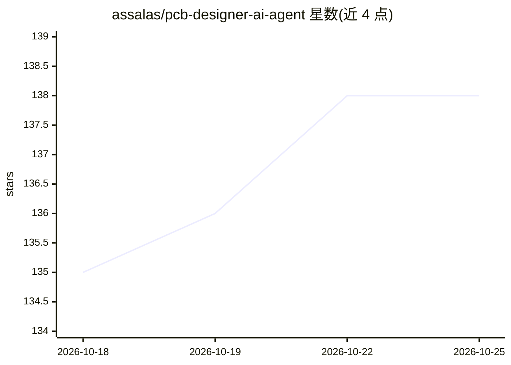

# assalas/pcb-designer-ai-agent

⭐ 138 · Python · NOASSERTION · 推送 2026-10-03 · [GitHub](https://github.com/assalas/pcb-designer-ai-agent) · [官网](https://github.com/assalas/pcb-designer-ai-agent) · 个人维护

**LLM 驱动的 PCB 设计助手：自然语言生成原理图与版图**

以 Python 实现的端到端 PCB 设计 agent：接收自然语言板卡描述（如含 ESP32、IMU、USB-C 的需求），由 LLM 解析需求、映射真实器件生成 BOM、合成原理图网表、生成标准 IPC 封装几何，并输出可直接布线的 .kicad_pcb 板文件。以独立 JSON-RPC 服务形式运行，模型无关，支持 Claude/Gemini/OpenAI/OpenRouter 及 LM Studio/Ollama 本地模型；另提供 Anna OS 应用部署方式与基于 Reef 的 LLM 评测 harness。面向硬件开发者。

## 筛选速览

| 维度 | 判定 | 备注 |
|---|---|---|
| AI 角色 | `ai-native` | 本体是模型或模型工具 |
| 许可风险 | `none` | NOASSERTION |
| 部署形态 | `None` |  |
| 模型依赖 | local-ok | 支持本地模型 |
| 硬件要求 | — | 无带数字的原话,不猜 |
| 安装摩擦 | `low` | 无编译、无系统依赖或容器化 |
| 成熟度 | — | 结构信号不足 |

## 能力要点

- 自然语言→BOM→网表→IPC 封装→.kicad_pcb 文件的端到端流水线
- 模型无关：支持 Claude/Gemini/OpenAI/OpenRouter 及 LM Studio/Ollama 本地模型
- OpenRouter 免费模型限流时自动回退
- 内置 Reef 评测 harness 评估 LLM 从 PDF 数据手册提取封装参数的能力

## 适用场景

- 用一句话描述需求快速生成可布线的 PCB 初版设计
- 在本地（LM Studio/Ollama）离线运行硬件设计 agent
- 评估不同 LLM 在电子工程封装参数提取任务上的表现

## 场景标签

`模型评测` · 领域:评测与运维

## 证据(README 行号)

> L3: End-to-End PCB Design Assistant powered by LLMs.
> L5: This is a **universal** AI hardware agent built in Python. It supports any major LLM provider (Claude, Gemini, OpenA
> L16: 5. Renders a complete, routing-ready `.kicad_pcb` board file!

## 星数曲线

2026-10-18 135 → 2026-10-25 138（+3）

---
*卡片 v1 · prompt 1.4 · 生成 2026-10-22 · 置信度 high · 依据 README sha `a5b1c405e45e` · [字段定义](../../DATASET.md)*
