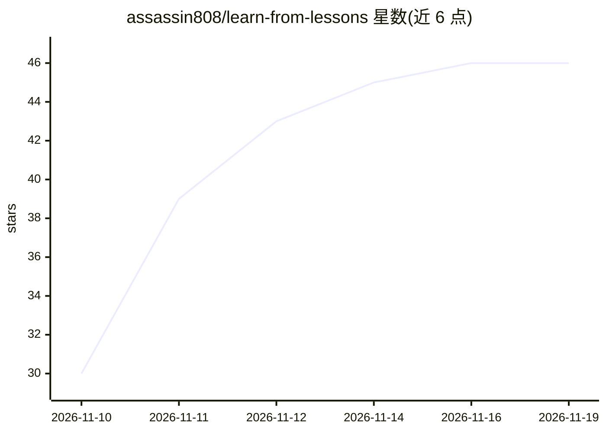

# assassin808/learn-from-lessons

⭐ 46 · Python · MIT · 推送 2026-11-09 · [GitHub](https://github.com/assassin808/learn-from-lessons) · 个人维护

**让编码 agent 从用户纠正中沉淀经验教训的工具**

读取本机已有的 Claude Code、Codex、opencode 会话转录，定位用户纠正 agent 的时刻，将其转化为带原始引文的短教训（lessons）；教训分 principle/rules/cases 三层，被验证两次后标记 verified，可按场景过滤、以列表/图谱浏览，并注入 CLAUDE.md、AGENTS.md 或经 MCP server 供 agent 下次加载。通过 pipx 安装，Python 3.9+，无其他依赖，全程本地运行；lesson 生成依赖用户已有的 claude/codex CLI。设计参照 Anthropic 的 Agent Memory 组件文章。

## 筛选速览

| 维度 | 判定 | 备注 |
|---|---|---|
| AI 角色 | `ai-ecosystem` | LLM/agent 周边工具 |
| 许可风险 | `permissive` | MIT |
| 部署形态 | `None` |  |
| 模型依赖 | — | README 未给出锁定关系 |
| 硬件要求 | — | 无带数字的原话,不猜 |
| 安装摩擦 | `low` | 无编译、无系统依赖或容器化 |
| 成熟度 | — | 结构信号不足 |

## 能力要点

- 从本机转录中抽取纠正并生成带引文的教训
- 教训分 principle/rules/cases 三层，见过两次标记 verified
- 以 Claude Code skill、AGENTS.md 块与 MCP server 三种形式注入
- Python 3.9+、无其他依赖、全程本地运行

## 适用场景

- 不想反复纠正编码 agent 同样问题的开发者
- 按场景（如写论文 vs 开发）管理不同的 agent 经验
- 查看教训图谱与来源证据以核验 agent 行为

## 场景标签

`Agent 记忆` · 领域:Agent 开发

## 证据(README 行号)

> L14: and next session it does it again. **Learn from Lessons** reads the transcripts already on your machine (Claude
> L44: Also ships as a Claude Code skill, an AGENTS.md block for Codex and

## 星数曲线

2026-11-10 30 → 2026-11-19 46（+16）

---
*卡片 v1 · prompt 1.4 · 生成 2026-11-18 · 置信度 high · 依据 README sha `1f589b2abb5a` · [字段定义](../../DATASET.md)*
