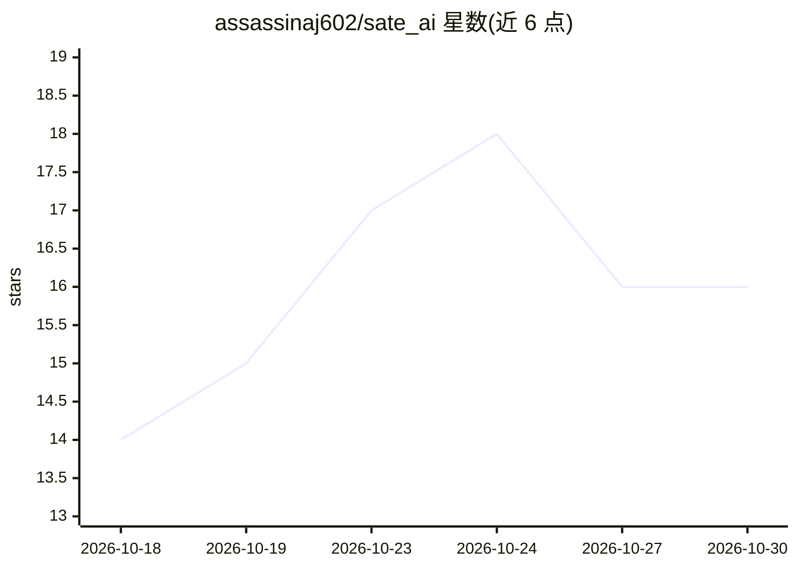

# assassinaj602/sate_ai

⭐ 16 · Dart · MIT · 推送 2026-10-20 · [GitHub](https://github.com/assassinaj602/sate_ai) · [官网](https://assassinaj602.github.io/sate_ai/) · 个人维护

**面向端侧 AI 模型的故障注入与可靠性测试框架**

为 Flutter、Android、Web/Node.js 和 CLI 环境下的端侧 AI 模型提供故障注入与韧性测试：11 种故障注入器模拟内存压力、畸形输入、量化漂移、热节流、网络中断等场景，通过 8 种模型适配器（ONNX、TFLite、Fllama/llama.cpp、MediaPipe、Core ML、ML Kit 等）连接待测模型，输出 JSON/Markdown/HTML 报告，支持 CLI、GitHub Actions、DevTools 扩展与 SSE 实时监控。纯 Dart 核心（sate_core）与 Flutter 包（sate_ai）解耦。限制：TFLite 适配器激活时不支持 Web 构建；iOS/macOS 原生与 Python 包为路线图计划。

## 筛选速览

| 维度 | 判定 | 备注 |
|---|---|---|
| AI 角色 | `ai-ecosystem` | LLM/agent 周边工具 |
| 许可风险 | `permissive` | MIT |
| 部署形态 | `None` |  |
| 模型依赖 | local-ok | 支持本地模型 |
| 硬件要求 | — | 无带数字的原话,不猜 |
| 安装摩擦 | `low` | 无编译、无系统依赖或容器化 |
| 成熟度 | — | 结构信号不足 |

## 能力要点

- 11 种故障注入器覆盖内存、I/O、热、网络等故障模式
- 8 种模型适配器（ONNX/TFLite/Fllama/MediaPipe/Core ML/ML Kit 等）
- CLI 无需 Flutter SDK，支持 CI/CD 集成与 GitHub Marketplace Action
- 黄金基线回归检测、SQLite 历史报告与实时 SSE 监控面板

## 适用场景

- 端侧模型上线前做压力与故障注入测试
- 在 CI 流水线中自动化验证模型可靠性
- 分析 ONNX/TFLite 模型的量化影响

## 场景标签

`模型评测` · 领域:评测与运维

## 证据(README 行号)

> L89: SATE AI is a fault injection and resilience testing framework for on-device AI
> L102: - 8 model adapters: MockAdapter, OnnxAdapter, TFLiteAdapter, FllamaAdapter,

## 星数曲线

2026-10-18 14 → 2026-10-30 16（+2）

---
*卡片 v1 · prompt 1.4 · 生成 2026-10-30 · 置信度 high · 依据 README sha `709df897982f` · [字段定义](../../DATASET.md)*
