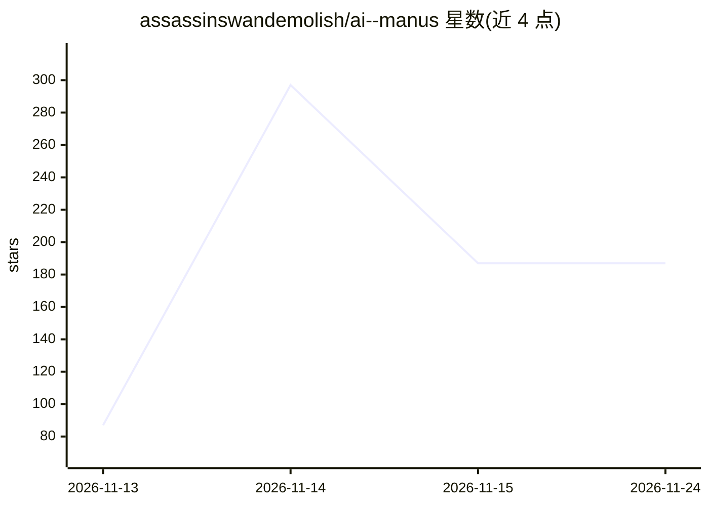

# assassinswandemolish/ai--manus

⭐ 187 · Apache-2.0 · 推送 2026-11-15 · [GitHub](https://github.com/assassinswandemolish/ai--manus) · 个人维护

**自主执行代码与浏览器的通用 AI Agent 系统**

名为 Manus 的自主 AI Agent 系统，在沙盒环境中运行各类工具与操作：代表用户编写并执行脚本、控制浏览器导航网页/填表/采集信息、执行多步骤任务。定位为面向家庭、学习与轻量工作的个人助手，而非企业平台。README 提供硬件兼容表（最低双核 CPU/4GB RAM，推荐 8GB+）与六步上手流程，但未给出具体安装命令、模型接入方式或代码结构说明，可验证的运行细节有限。

## 筛选速览

| 维度 | 判定 | 备注 |
|---|---|---|
| AI 角色 | `ai-native` | 本体是模型或模型工具 |
| 许可风险 | `permissive` | Apache-2.0 |
| 部署形态 | `None` |  |
| 模型依赖 | — | README 未给出锁定关系 |
| 硬件要求 | — | 无带数字的原话,不猜 |
| 安装摩擦 | `low` | 无编译、无系统依赖或容器化 |
| 成熟度 | — | 结构信号不足 |

## 能力要点

- 自主执行代码完成任务的 Agent 能力
- 浏览器控制：导航、填表、信息采集
- 脚本与浏览器动作可在同一任务流中衔接
- 面向学习、家庭与轻量办公场景

## 适用场景

- 让 Agent 代为收集资料、整理研究笔记
- 自动填写重复表单与多页面信息采集
- 后台处理日常小型自动化任务

## 场景标签

`AI 助手` `浏览器自动化` `编码 Agent` · 领域:效率与自动化

## 证据(README 行号)

> L10: - **Autonomous Code Execution:** Manus AI agent runs code on its own to complete tasks, so you can focus on decisio
> L18: Manus is an autonomous AI agent designed to run code and control a browser on your behalf. Instead of acting like a

## 星数曲线

2026-11-13 87 → 2026-11-24 187（+100）

---
*卡片 v1 · prompt 1.4 · 生成 2026-11-17 · 置信度 low · 依据 README sha `a3d88e202bf0` · [字段定义](../../DATASET.md)*
